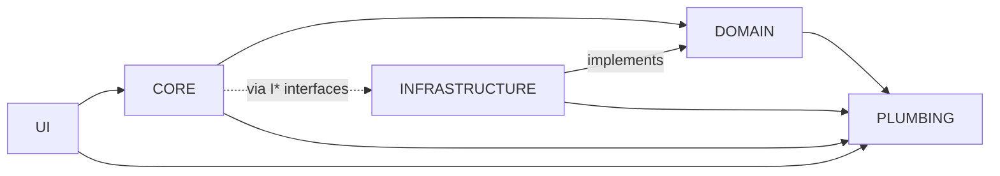

<!-- [LAYER: UI] -->
# HEAV3NS-JOY

> *"Do not build another place where agents run. Build something agents can learn from, carry away, and independently reproduce."*

**HEAV3NS-JOY** is an agnostic, agent-native, repository-distributed framework for software development based on **Joyzoning** (Architectural Sovereignty, Geographic Alignment, and Structural Entropy Control).

It is **not** an agent harness, model router, runtime, or MCP server. It requires zero vendor lock-in, zero preinstalled skills, and zero external services. The repository itself is the propagation substrate: any capable coding agent or developer can inspect this repository, acquire the conventions in under 60 seconds, and apply or reproduce them in any codebase across any language.

---

[](https://github.com/CardSorting/HEAV3NS-JOY/actions/workflows/ci.yml)
[](LICENSE)


## Table of Contents

- [Quick Start](#quick-start-under-2-minutes)
- [Find Your Path](#find-your-path)
- [Zones at a Glance](#zones-at-a-glance)
- [Common Tasks](#common-tasks)
- [Troubleshooting](#troubleshooting)
- [FAQ](#faq)
- [The Five Questions Every Agent Must Answer](#the-five-questions-every-agent-must-answer)
- [60-Second Quick Reference Card](#60-second-quick-reference-card)
- [Progressive Discovery Map](#progressive-discovery-map)
- [Contributing, Security & License](#contributing-security--license)

## Quick Start (under 2 minutes)

**Requirements:** Node.js 18+ and git. No `npm install` is needed: there are zero dependencies.

```bash
git clone https://github.com/CardSorting/HEAV3NS-JOY.git
cd HEAV3NS-JOY

npm test                              # run the test suite
npm run joy-check                     # audit this repo against its own rules
node bin/joy-check.mjs /path/to/your/project          # audit YOUR project
node bin/joy-check.mjs /path/to/your/project --init   # scaffold config + .joyignore
```

A passing audit ends with `Blocking Violations (0): None. 100% Joyzoning Conformance.`
The command exits non-zero only on **blocking** violations, so it is safe to use as a CI gate. Advisories (`[INFO]`) never fail a build.

## Find Your Path

| You are... | Start here | Then |
| :--- | :--- | :--- |
| **Evaluating / stakeholder** | [Whitepaper](docs/papers/whitepaper.md), [Companion Brief](docs/papers/companion-brief.md), [VALIDATION_REPORT.md](VALIDATION_REPORT.md) | [ROADMAP.md](ROADMAP.md), [CHANGELOG.md](CHANGELOG.md) |
| **Developer adopting it** | [Getting Started](docs/GETTING_STARTED.md), [Adopting in existing projects](workflows/03-ADOPTING-IN-EXISTING-PROJECTS.md) | [Examples](examples/typescript/violations-and-fixes.md), [CLI reference](docs/api/cli.md) |
| **AI coding agent** | [AGENTS.md](AGENTS.md) (60-second protocol) | [Agent Stack](docs/AGENT_STACK.md), [Error codes](docs/api/errors.md) |
| **Maintainer / contributor** | [CONTRIBUTING.md](CONTRIBUTING.md), [Maintainer guide](docs/MAINTAINER.md), [Releasing](docs/RELEASING.md) | [Codebase standards](docs/CODEBASE_STANDARDS.md), [Code-to-doc map](docs/CODE_TO_DOC_MAP.md) |
| **Security reviewer** | [SECURITY.md](SECURITY.md) | [Security best practices](docs/SECURITY_BEST_PRACTICES.md) |
| **Integrating programmatically** | [Public API](docs/api/public-api.md) | [`src/index.mjs`](src/index.mjs) |

## Zones at a Glance



| Zone | Directory | Owns | Must never |
| :--- | :--- | :--- | :--- |
| `DOMAIN` | `src/domain/` | Business rules, entities, `I*` contracts | Do I/O or import infrastructure/ui |
| `CORE` | `src/core/` | Use-case orchestration, policies | Import `ui` |
| `INFRASTRUCTURE` | `src/infrastructure/` | fs/http/db adapters | Import `ui`, hold business logic |
| `PLUMBING` | `src/plumbing/`, `src/utils/` | Stateless helpers | Import any other zone, keep mutable state |
| `UI` | `src/ui/` | Presenters, CLI, views | Import `infrastructure` directly |

## Common Tasks

| I want to... | Run |
| :--- | :--- |
| Audit a project | `node bin/joy-check.mjs <path>` |
| Add missing `[LAYER]` headers (preview first) | `node bin/joy-check.mjs <path> --heal --dry-run` |
| Understand a violation | `node bin/joy-check.mjs --explain SPI-206` |
| Gate CI / PRs | See [CI integration](docs/CI_INTEGRATION.md) (GitHub Actions, GitLab, hooks) |
| Gate commits | Install [`configs/pre-commit-hook.sh`](configs/pre-commit-hook.sh) as `.git/hooks/pre-commit` |
| Validate the docs | `npm run docs:check` |
| Run everything CI runs | `npm run verify` |
| See machine-readable output | `--format sarif\|github\|junit\|tap\|ndjson\|lsp\|compact\|markdown` or `--json` |

## Troubleshooting

| Symptom | Likely cause | Fix |
| :--- | :--- | :--- |
| Every file reports a missing header | Headers absent in a fresh adoption | `--heal --dry-run`, review, then `--heal` |
| Files are flagged in the wrong zone | Non-canonical directory names | Map them in `stability.config.json` / `spider.spec.json` (`--init` scaffolds this) |
| Vendored/generated code is noisy | Not excluded | List paths in `.joyignore` |
| `SPI-201` circular dependency | Two modules import each other | Extract a contract to `domain/interfaces/` or a helper to `plumbing/` (`--explain SPI-201`) |
| `docs:check` reports a broken link | Moved or renamed file | Fix the link; run `npm run docs:check` again |
| `SyntaxError` on startup | Node older than 18 | Upgrade Node (`.nvmrc` pins 18) |

## FAQ

**Is this a runtime, SDK, or MCP server?** No. It is a convention set plus a zero-dependency validator you can copy anywhere.

**Does it only work with TypeScript?** No. JavaScript, Python, Go, Rust, Java, C/C++, SQL, and Markdown are supported; new languages need only a comment-syntax entry.

**Will it block my team on stylistic issues?** No. Only hard architectural violations are blocking; everything else is an advisory.

**Do I have to rename my folders?** No. Map existing layouts to zones in config.

**Unfamiliar term?** See the [Glossary](docs/GLOSSARY.md). **Need help?** See [SUPPORT.md](SUPPORT.md).

**Where do I report a security issue?** Privately, per [SECURITY.md](SECURITY.md).

---

## The Five Questions Every Agent Must Answer

When encountering HEAV3NS-JOY for the first time, use this direct operational index:

### 1. What is this framework?
**Joyzoning** is a deterministic software architecture and development methodology that eliminates architectural drift ("entropy") by binding every source file to one of **Five Canonical Zones** (`DOMAIN`, `CORE`, `INFRASTRUCTURE`, `PLUMBING`, `UI`), enforcing explicit top-of-file layer headers (`[LAYER: <ZONE>]`), matching physical directory geography to declared zones, restricting cross-zone dependency directions, and governing refactoring through graph forensics (Spider Metrics) and tactical standard operating procedures (SOPs).
- Read: [`spec/00-CANONICAL-MODEL.md`](spec/00-CANONICAL-MODEL.md)

### 2. What principles govern it?
Six foundational axioms govern every Joyzoned codebase:
1. **Archetypal Primacy**: Every source file declares its architectural identity at the top of the file (`/** [LAYER: DOMAIN] */`, `# [LAYER: CORE]`, etc.) within the first 10,000 characters.
2. **Principle of Geographic Alignment (PGA)**: A file's physical directory path (`src/domain/`, `src/core/`, `src/infrastructure/`, `src/plumbing/`, `src/ui/`) must match its `[LAYER: <ZONE>]` header tag.
3. **Domain Purity (0% I/O Entropy)**: The `DOMAIN` zone encapsulates pure business rules and contracts. It is strictly forbidden from performing I/O (`fs`, `http`, `fetch`, `net`, raw DB drivers) or importing from `INFRASTRUCTURE` or `UI`.
4. **Strict Dependency Direction & Depth**: Dependencies flow inward toward contracts. Relative imports must never traverse more than 3 parent directories (`../../..`). Directory nesting targets a maximum depth of 4.
5. **Contractual Sovereignty (Dependency Inversion)**: Concrete domain/core services implement explicit contracts (`I<ClassName>`) housed in `domain/interfaces/`.
6. **Progressive, Non-Deadlocking Enforcement**: Structural rules distinguish between hard architectural blocks (e.g., runtime circular dependencies `SPI-201`, cross-layer leaks `SPI-206`, Domain I/O leaks) and non-blocking advisories (`SPI-101..112`), deferring to compiler/test truth so agents never enter infinite repair loops.
- Read: [`spec/01-SYNTAX-AND-HEADERS.md`](spec/01-SYNTAX-AND-HEADERS.md) and [`spec/02-DEPENDENCY-AND-COMPOSITION-RULES.md`](spec/02-DEPENDENCY-AND-COMPOSITION-RULES.md)

### 3. How do I apply it to a project?
Whether starting a greenfield system or adopting Joyzoning in an existing TypeScript, Python, Go, or Rust repository:
1. Perform a **Triad Audit** (Architect, Critic, SRE) before writing or moving code.
2. Map or organize directories into the 5 canonical zones (or map existing paths via `spider.spec.json` / `stability.config.json`).
3. Stamp every file with its language-appropriate `[LAYER: <ZONE>]` header tag.
4. Route dependencies strictly according to the Layer Coupling Matrix and extract shared contracts (`I*`) to break cycles.
- Read: [`AGENTS.md`](AGENTS.md) (60-Second Agent Acquisition Protocol) and [`workflows/03-ADOPTING-IN-EXISTING-PROJECTS.md`](workflows/03-ADOPTING-IN-EXISTING-PROJECTS.md)

### 4. How do I know my implementation conforms?
Conformance is deterministic and verifiable either by inspecting against the explicit rubric or by running the zero-dependency reference validator included in this repository:
```bash
# Validate any project directory (or this repository itself)
node bin/joy-check.mjs <path-to-project>

# Scaffold ready-to-use stability.config.json and .joyignore in any repository
node bin/joy-check.mjs <path-to-project> --init

# Auto-heal missing or misaligned [LAYER: ...] header tags (use --dry-run to preview)
node bin/joy-check.mjs <path-to-project> --heal

# Auto-heal un-reassigned top-level let/var bindings in PLUMBING to const
node bin/joy-check.mjs <path-to-project> --heal-stateless

# Run StabilityDoctor architectural health checkup or Multivariate Statistics (--stats)
node bin/joy-check.mjs <path-to-project> --doctor
node bin/joy-check.mjs <path-to-project> --stats

# Explain any SPI-xxx or RTG-0xx forensic code or canonical zone with before/after fix recipes
node bin/joy-check.mjs --explain SPI-206
node bin/joy-check.mjs --explain SPI-108
node bin/joy-check.mjs --explain RTG-003
node bin/joy-check.mjs --explain BROCCOLIDB

# Scoped pre-edit neighborhood check & structural AST skeletonization (65-85% token reduction)
node bin/joy-check.mjs <path-to-project> --phase pre-edit --scope src/core/SpiderEngine.mjs --neighborhood 1 --format compact
node bin/joy-check.mjs <path-to-project> --skeleton src/core/SpiderEngine.mjs --keep-symbol auditProject

# Emit SARIF 2.1.0, LSP Diagnostics, TAP v13, JUnit XML, NDJSON, Compact, GitHub Actions, Markdown, or JSON
node bin/joy-check.mjs <path-to-project> --format compact
node bin/joy-check.mjs <path-to-project> --format lsp
node bin/joy-check.mjs <path-to-project> --format tap
node bin/joy-check.mjs <path-to-project> --format junit
node bin/joy-check.mjs <path-to-project> --format ndjson
node bin/joy-check.mjs <path-to-project> --format sarif
node bin/joy-check.mjs <path-to-project> --format github
node bin/joy-check.mjs <path-to-project> --format markdown --mermaid
node bin/joy-check.mjs <path-to-project> --json
```
- Read: [`spec/03-METRICS-AND-FORENSICS.md`](spec/03-METRICS-AND-FORENSICS.md), [`spec/04-ENFORCEMENT-AND-LENIENCY.md`](spec/04-ENFORCEMENT-AND-LENIENCY.md), and [`spec/05-PORTABLE-SUBSTRATE-TRINITY.md`](spec/05-PORTABLE-SUBSTRATE-TRINITY.md)

### 5. How can I extend it without violating its conventions?
- Custom directory layouts can map onto the 5 canonical zones using `spider.spec.json` or `stability.config.json` without renaming legacy folders immediately.
- New language support requires only registering the file extension's comment syntax in the Header Comment Registry (`JSDOC`, `SLASH`, `HASH`, `DASH`, `HTML`) and import extractor.
- Legitimate architectural exceptions (such as a platform host bridge or generated wire code) use explicit, auditable inline directives (`@joyzoning-bypass <reason>` or `@sovereign-ignore <rule-id>`) rather than silent rule erosion.
- Read: [`spec/00-CANONICAL-MODEL.md#extending-joyzoning`](spec/00-CANONICAL-MODEL.md) and [`workflows/02-TACTICAL-REFACTORING-SOPS.md`](workflows/02-TACTICAL-REFACTORING-SOPS.md)

---

## 60-Second Quick Reference Card

| Zone | Canonical Path | Header Tag (TS/JS/Java) | Header Tag (Py/Sh/Rb) | Header Tag (Go/Rs/C) | Max I/O Entropy | Allowed Zone Imports | Forbidden Zone Imports |
| :--- | :--- | :--- | :--- | :--- | :---: | :--- | :--- |
| **DOMAIN** | `src/domain/` | `/** [LAYER: DOMAIN] */` | `# [LAYER: DOMAIN]` | `// [LAYER: DOMAIN]` | `0.00` (0%) | `domain`, `plumbing` | `infrastructure`, `ui`, `core`*, raw I/O |
| **CORE** | `src/core/` | `/** [LAYER: CORE] */` | `# [LAYER: CORE]` | `// [LAYER: CORE]` | `0.00` (0%) | `core`, `domain`, `plumbing`, `infrastructure` (via interfaces) | `ui`, direct raw I/O |
| **INFRASTRUCTURE** | `src/infrastructure/` | `/** [LAYER: INFRASTRUCTURE] */` | `# [LAYER: INFRASTRUCTURE]` | `// [LAYER: INFRASTRUCTURE]` | `1.00` (100%) | `infrastructure`, `plumbing`, `domain` (interfaces only)* | `ui`, concrete `domain` logic |
| **UI** | `src/ui/` | `/** [LAYER: UI] */` | `# [LAYER: UI]` | `// [LAYER: UI]` | `1.00` (100%) | `ui`, `core`, `domain` (types/contracts), `plumbing` | `infrastructure` |
| **PLUMBING** | `src/plumbing/` (`src/utils/`) | `/** [LAYER: PLUMBING] */` | `# [LAYER: PLUMBING]` | `// [LAYER: PLUMBING]` | `0.00` (0%) | `plumbing` only | `domain`, `core`, `infrastructure`, `ui` |

*\*See [`spec/02-DEPENDENCY-AND-COMPOSITION-RULES.md`](spec/02-DEPENDENCY-AND-COMPOSITION-RULES.md) for the exact distinction between interface/type imports (`domain/interfaces/`) and concrete implementation coupling.*

---

## Progressive Discovery Map

Do not read the entire repository unless needed. Follow the path that matches your immediate task:

- **I am an agent tasked with building or refactoring a project using Joyzoning right now:**
  1. Read [`AGENTS.md`](AGENTS.md) for the step-by-step operational protocol.
  2. Inspect [`examples/typescript/`](examples/typescript/) or [`examples/polyglot/`](examples/polyglot/) for working code patterns.
  3. Run `node bin/joy-check.mjs <target-dir>` to verify your work.
- **I need the exact syntax for headers, imports, or layer rules:**
  - [`spec/00-CANONICAL-MODEL.md`](spec/00-CANONICAL-MODEL.md) — The 5 zones, core terminology, foundational vs. LUMI-incidental distinction.
  - [`spec/01-SYNTAX-AND-HEADERS.md`](spec/01-SYNTAX-AND-HEADERS.md) — Multi-language header syntax, placement rules, and whitelists.
  - [`spec/02-DEPENDENCY-AND-COMPOSITION-RULES.md`](spec/02-DEPENDENCY-AND-COMPOSITION-RULES.md) — Coupling matrix, import depth (`<= 3`), Contractual Sovereignty (`I<Class>`), Barrel Sovereignty.
- **I need to diagnose structural smells, cycles, or SPI-xxx error codes:**
  - [`spec/03-METRICS-AND-FORENSICS.md`](spec/03-METRICS-AND-FORENSICS.md) — Spider Engine math, 5-factor Structural Entropy, Blast Radius, Tarjan Bridges, and `SPI-101..403` catalog.
  - [`spec/04-ENFORCEMENT-AND-LENIENCY.md`](spec/04-ENFORCEMENT-AND-LENIENCY.md) — Strike 1 vs. Advisory TIA, enforcement themes (`strict`, `relaxed`, `safety`), and escape hatches.
  - [`examples/typescript/violations-and-fixes.md`](examples/typescript/violations-and-fixes.md) — Concrete before/after diffs fixing every violation type.
- **I need to plan a complex feature or execute a large-scale refactoring:**
  - [`workflows/01-TRIAD-AUDIT-PLANNING.md`](workflows/01-TRIAD-AUDIT-PLANNING.md) — Pre-implementation review (Architect, Critic, SRE).
  - [`workflows/02-TACTICAL-REFACTORING-SOPS.md`](workflows/02-TACTICAL-REFACTORING-SOPS.md) — The 9 Tactical SOPs (`DECOMPOSE`, `MOVE`, `EXTRACT`, `PRUNE`, `ALIGN_TAGS`, `HEAL_STATELESSNESS`, `HARDEN`, `DECOUPLE`, `FIX_STRUCTURAL_VIOLATION`) and Producer-Before-Consumer batch order.
  - [`workflows/03-ADOPTING-IN-EXISTING-PROJECTS.md`](workflows/03-ADOPTING-IN-EXISTING-PROJECTS.md) — Incremental migration playbook for brownfield repositories.
  - [`workflows/04-EXECUTION-ERGONOMICS-JOYRIDE.md`](workflows/04-EXECUTION-ERGONOMICS-JOYRIDE.md) — Bounded, invalidation-aware execution caching principles (JoyRide).
  - [`spec/05-PORTABLE-SUBSTRATE-TRINITY.md`](spec/05-PORTABLE-SUBSTRATE-TRINITY.md) & [`workflows/05-PORTABLE-SPIDER-AND-BROCCOLIDB.md`](workflows/05-PORTABLE-SPIDER-AND-BROCCOLIDB.md) — Zero-dependency **JoyRide** (11-point fingerprint validation, single-flight), **Spider Agent Ergonomics** (Merkle reality shield `SPI-006`, semantic footprints, $N$-hop neighborhood scoping, AST skeletonization), and **BroccoliDB** (sharded SHA-256 CAS with corruption quarantine, RFC 1952 `BroccoliWireEngine`, and `RuntimeStateGraph` `RTG-001..008`).
- **I want to inspect or run the reference validator (which itself is 100% Joyzoned):**
  - [`src/domain/`](src/domain/) — Pure Joyzoning rules ([`joyRules.mjs`](src/domain/joyRules.mjs)), BroccoliDB & Spider ergonomics rules ([`broccoliRules.mjs`](src/domain/broccoliRules.mjs)), entropy/Martin/Gini equations ([`entropyFormulas.mjs`](src/domain/entropyFormulas.mjs)), and contracts ([`IWorkspaceScanner.mjs`](src/domain/interfaces/IWorkspaceScanner.mjs), [`ICasStorage.mjs`](src/domain/interfaces/ICasStorage.mjs)).
  - [`src/core/`](src/core/) — Spider dependency & forensic engine ([`SpiderEngine.mjs`](src/core/SpiderEngine.mjs)), Spider agent toolkit ([`SpiderToolkit.mjs`](src/core/SpiderToolkit.mjs)), BroccoliDB governed runtime ([`BroccoliRuntime.mjs`](src/core/BroccoliRuntime.mjs)) and state graph ([`RuntimeStateGraph.mjs`](src/core/RuntimeStateGraph.mjs)), StabilityDoctor optimizer ([`StabilityDoctor.mjs`](src/core/StabilityDoctor.mjs)), self-healing & import-rewiring engine ([`RefactorHealer.mjs`](src/core/RefactorHealer.mjs)), and bounded JoyRide execution cache ([`JoyRideCache.mjs`](src/core/JoyRideCache.mjs)).
  - [`src/infrastructure/`](src/infrastructure/) — File system scanner ([`NodeWorkspaceScanner.mjs`](src/infrastructure/NodeWorkspaceScanner.mjs)) and sharded SHA-256 CAS + RFC 1952 multi-member GZIP Wire Engine ([`NodeCasStorage.mjs`](src/infrastructure/NodeCasStorage.mjs)).
  - [`src/plumbing/`](src/plumbing/) — Pure FIPS 180-4 SHA-256, canonical JSON, output summarizer, & AST skeletonizer ([`canonicalHash.mjs`](src/plumbing/canonicalHash.mjs)), stateless path/Levenshtein utilities ([`pathUtils.mjs`](src/plumbing/pathUtils.mjs)), polyglot comment registry ([`commentStyles.mjs`](src/plumbing/commentStyles.mjs)), single-pass lexical tokenizer ([`codeTokenizer.mjs`](src/plumbing/codeTokenizer.mjs)), and polyglot import/export/metrics scanner ([`sourceScanner.mjs`](src/plumbing/sourceScanner.mjs)).
  - [`src/ui/`](src/ui/) — Terminal, StabilityDoctor, SARIF 2.1.0, GitHub Actions, Markdown, Explain, and Mermaid presenters ([`CliFormatter.mjs`](src/ui/CliFormatter.mjs)), plus Compact, LSP, TAP v13, JUnit XML, and NDJSON formatters ([`AgentFormatters.mjs`](src/ui/AgentFormatters.mjs)).
  - [`configs/`](configs/) — Drop-in [`stability.config.json`](configs/stability.config.json), [`spider.spec.json`](configs/spider.spec.json), [`pre-commit-hook.sh`](configs/pre-commit-hook.sh), and [`github-action.yml`](configs/github-action.yml) templates.
  - [`docs/`](docs/README.md) — Complete documentation hub: [Agent Stack](docs/AGENT_STACK.md), [Project Map](docs/PROJECT_MAP.md), [Code-to-Doc Map](docs/CODE_TO_DOC_MAP.md), [Constitution](docs/CONSTITUTION.md), [Papers](docs/papers/README.md) ([Companion Brief](docs/papers/companion-brief.md), [Philosophy](docs/papers/philosophy.md), [Whitepaper](docs/papers/whitepaper.md)), and [Programmatic & CLI API](docs/api/README.md) ([Public API](docs/api/public-api.md), [CLI](docs/api/cli.md), [Errors](docs/api/errors.md)).
  - [`VALIDATION_REPORT.md`](VALIDATION_REPORT.md) — Results of self-conformance and clean-room acquisition experiments.

---

## Contributing, Security & License

- Contribute via [CONTRIBUTING.md](CONTRIBUTING.md) and follow the [Code of Conduct](CODE_OF_CONDUCT.md). PRs get a checklist from the [PR template](.github/PULL_REQUEST_TEMPLATE.md).
- Report vulnerabilities privately per [SECURITY.md](SECURITY.md).
- Released under the [MIT License](LICENSE). See the [CHANGELOG](CHANGELOG.md) and [ROADMAP](ROADMAP.md).
