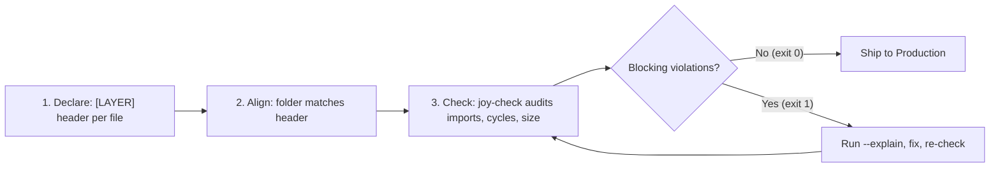
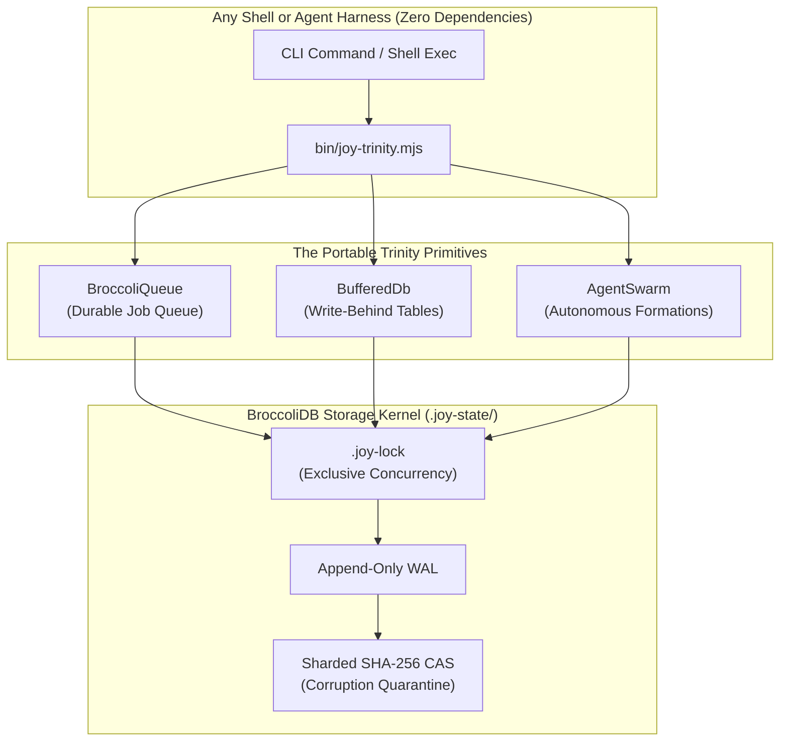
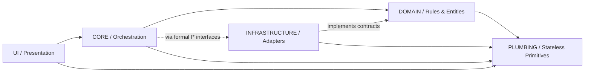

<!-- [LAYER: UI] -->
# HEAV3NS-JOY: Architectural Sovereignty & Structural Entropy Control

<div align="center">

```text
██╗  ██╗███████╗ █████╗ ██╗   ██╗██████╗ ███╗   ██╗███████╗      ██╗ ██████╗ ██╗   ██╗
██║  ██║██╔════╝██╔══██╗██║   ██║╚════██╗████╗  ██║██╔════╝      ██║██╔═══██╗╚██╗ ██╔╝
███████║█████╗  ███████║██║   ██║ █████╔╝██╔██╗ ██║███████╗█████╗██║██║   ██║ ╚████╔╝ 
██╔══██║██╔══╝  ██╔══██║╚██╗ ██╔╝ ╚═══██╗██║╚██╗██║╚════██║╚════╝██║██║   ██║  ╚██╔╝  
██║  ██║███████╗██║  ██║ ╚████╔╝ ██████╔╝██║ ╚████║███████║      ██║╚██████╔╝   ██║   
╚═╝  ╚═╝╚══════╝╚═╝  ╚═╝  ╚═══╝  ╚═════╝ ╚═╝  ╚═══╝╚══════╝      ╚═╝ ╚═════╝    ╚═╝   
```

### Agnostic • Agent-Native • Zero-Dependency Architectural Sovereignty Framework

[](https://github.com/CardSorting/HEAV3NS-JOY/actions/workflows/ci.yml)
[](LICENSE)
[](https://nodejs.org)
[](#philosophy)
[](docs/CONSTITUTION.md)
[](tests/)
[](#set-up-your-agents-joy-init)

> *"Do not build another place where agents run. Build something agents can learn from, carry away, and independently reproduce."*

<p align="center">
  <b>HEAV3NS-JOY</b> is an agnostic, agent-native, repository-distributed framework for software engineering based on <b>Joyzoning</b> (Architectural Sovereignty, Geographic Alignment, and Structural Entropy Control).
</p>

<p align="center">
  <b>In one sentence:</b> HEAV3NS-JOY keeps codebases (yours and your AI agents') architecturally honest, using a tiny convention plus a zero-dependency checker.
</p>

</div>

---

<details>
<summary>🌐 <b>Read this overview in another language (18 Translations Available)</b></summary>

<br/>

| Region | Language | Localized Overview |
|---|---|---|
| **East Asia** | 简体中文 (Simplified Chinese) | <span lang="zh-CN">[README.zh-CN.md](docs/i18n/README.zh-CN.md)</span> |
| | 繁體中文 (Traditional Chinese) | <span lang="zh-TW">[README.zh-TW.md](docs/i18n/README.zh-TW.md)</span> |
| | 日本語 (Japanese) | <span lang="ja-JP">[README.ja-JP.md](docs/i18n/README.ja-JP.md)</span> |
| | 한국어 (Korean) | <span lang="ko-KR">[README.ko-KR.md](docs/i18n/README.ko-KR.md)</span> |
| **Southeast Asia & South Asia** | Tiếng Việt (Vietnamese) | <span lang="vi">[README.vi.md](docs/i18n/README.vi.md)</span> |
| | Bahasa Indonesia (Indonesian) | <span lang="id">[README.id.md](docs/i18n/README.id.md)</span> |
| | हिन्दी (Hindi) | <span lang="hi">[README.hi.md](docs/i18n/README.hi.md)</span> |
| **Americas** | Español (Latinoamérica) | <span lang="es-419">[README.es-419.md](docs/i18n/README.es-419.md)</span> |
| | Português (Brasil) | <span lang="pt-BR">[README.pt-BR.md](docs/i18n/README.pt-BR.md)</span> |
| **Europe** | Français (French) | <span lang="fr">[README.fr.md](docs/i18n/README.fr.md)</span> |
| | Deutsch (German) | <span lang="de">[README.de.md](docs/i18n/README.de.md)</span> |
| | Italiano (Italian) | <span lang="it">[README.it.md](docs/i18n/README.it.md)</span> |
| | Русский (Russian) | <span lang="ru">[README.ru.md](docs/i18n/README.ru.md)</span> |
| | Українська (Ukrainian) | <span lang="uk">[README.uk.md](docs/i18n/README.uk.md)</span> |
| | Polski (Polish) | <span lang="pl">[README.pl.md](docs/i18n/README.pl.md)</span> |
| | Català (Catalan) | <span lang="ca">[README.ca.md](docs/i18n/README.ca.md)</span> |
| **Middle East & West Asia** | Türkçe (Turkish) | <span lang="tr">[README.tr.md](docs/i18n/README.tr.md)</span> |
| | العربية (Arabic) | <span lang="ar" dir="rtl">[README.ar.md](docs/i18n/README.ar.md)</span> |

</details>

---

## ⚡ Quick Navigation

- [💡 The Idea in 60 Seconds](#the-idea-in-60-seconds) — What it is, why it exists, restaurant metaphor.
- [🚀 Quick Start (Under 2 Minutes)](#quick-start-under-2-minutes) — Clone, test, and audit in seconds.
- [🤖 For AI Agents (60-Second Protocol)](#for-ai-agents) — Token-efficient scoping and decision rules.
- [📦 Set Up Your Agents (`joy init`)](#set-up-your-agents-joy-init) — Non-destructive setup for 8 coding agents.
- [🌐 Operate the Portable Trinity](#operate-the-portable-trinity-any-harness) — Durable jobs, write-behind DB, specialist swarms.
- [🏗️ The Five Canonical Zones](#zones-at-a-glance) — DOMAIN, CORE, INFRASTRUCTURE, PLUMBING, and UI.
- [🔬 See It in Action (Before & After)](#see-it-in-30-seconds) — Fixing architectural drift in code.
- [🧭 Find Your Path](#find-your-path) — Developers, agents, maintainers, operators, reviewers.
- [🛠️ Common Tasks & CLI Cheat Sheet](#common-tasks) — Diagnostic and self-healing commands.
- [📋 The Five Questions Every Agent Must Answer](#the-five-questions-every-agent-must-answer) — Operational primer.
- [🗂️ 60-Second Quick Reference Card](#60-second-quick-reference-card) — Zones, headers, path mappings, allowed imports.
- [🗺️ Progressive Discovery Map](#progressive-discovery-map) — Knowledgebase, ADRs, playbooks, postmortems.
- [🤝 Workspace Verification & Standards](#for-maintainers--operators) — Full verification gates.

---

## The Idea in 60 Seconds

| Dimension | Explanation |
| :--- | :--- |
| **What** | A tiny convention plus a zero-dependency checker. Every source file declares one of five canonical zones (`DOMAIN`, `CORE`, `INFRASTRUCTURE`, `PLUMBING`, `UI`) in a one-line top-of-file header tag. |
| **Why** | Architecture drifts silently, and AI coding agents accelerate the drift. Making structure machine-checkable stops erosion at the commit, not in a massive rewrite. |
| **How** | Place each file in the folder matching its zone, import only in allowed directions, and run `node bin/joy-check.mjs .`. Exit `0` means sound. |
| **Cost** | **Zero external dependencies**, no accounts, no network calls, read-only by default. |

### The Restaurant Metaphor

Think of a codebase as a high-end restaurant:
- **The Kitchen (`DOMAIN`)**: Prepares pure dishes and recipes (business rules). The kitchen **never** phones suppliers mid-recipe.
- **The Expediter (`CORE`)**: Coordinates order tickets, timing, and use-case workflows.
- **The Suppliers (`INFRASTRUCTURE`)**: Handles ingredient deliveries, cold storage, and external adapters (fs, HTTP, database).
- **The Dining Room (`UI`)**: Welcomes guests and serves plates. Waitstaff **never** enter the ingredient warehouse directly.
- **The Utility Lines (`PLUMBING`)**: Water, gas, and power lines. Pure stateless utilities that depend on nothing else.

Joyzoning labels each file with its room and checks that nobody uses a forbidden door.

```bash
# Try it now:
git clone https://github.com/CardSorting/HEAV3NS-JOY.git && cd HEAV3NS-JOY && npm run joy-check
```

**Pick your depth:** 1 minute (this section) → 5 minutes ([Getting Started](docs/GETTING_STARTED.md)) → 30 minutes ([Canonical Model](spec/00-CANONICAL-MODEL.md)) → deep dive ([Whitepaper](docs/papers/whitepaper.md)).

---

## Why this exists

Codebases rarely fail from one catastrophic decision. They drift: a database call sneaks into business logic, a UI component imports a low-level driver, two modules start importing each other cyclically. Code reviews catch some of it; AI coding agents, which write code rapidly and inspect only isolated context slices, produce more of it.

Joyzoning makes architecture **checkable instead of aspirational**. Every file declares which of five zones it belongs to, its folder must agree, and imports may only flow in allowed directions. A small, dependency-free tool verifies this in seconds, for humans in review and for agents mid-edit.

### See it in 30 seconds

```ts
// src/domain/Order.ts   <- business rules live here
/** [LAYER: DOMAIN] */
import fs from "node:fs";            // BLOCKED (SPI-206): domain must do zero I/O

// Fix: define a formal contract in the domain, implement it in infrastructure
// src/domain/interfaces/IOrderRepository.ts
/** [LAYER: DOMAIN] */
export interface IOrderRepository { save(order: Order): Promise<void>; }

// src/infrastructure/FileOrderRepository.ts
/** [LAYER: INFRASTRUCTURE] */
import fs from "node:fs";            // Valid: I/O belongs here
export class FileOrderRepository implements IOrderRepository { /* ... */ }
```

Explore more before/after pairs: [`examples/typescript/violations-and-fixes.md`](examples/typescript/violations-and-fixes.md).

---

## Philosophy

1. **Teach by repository, not by platform.** The repo itself is the product. Read it, copy it, reproduce it. No harness, SDK, account, or external service is required.
2. **Declare identity, then verify it.** A one-line header per file turns architecture from tribal knowledge into machine-readable data.
3. **Geography is meaning.** Where a file physically lives must match what it is.
4. **Dependencies point toward contracts.** Business rules never know about databases, screens, or network endpoints.
5. **Block only what is truly structural.** Cycles, layer leaks, and domain I/O fail the build (`exit 1`). Everything else is an advisory (`[INFO]`), so neither humans nor agents get stuck in infinite repair loops.
6. **Prefer compiler and test truth.** The validator is an architectural guardrail, not a substitute for your type checker or test suite.
7. **Small, sharp modules.** Size caps and nesting depth limits keep modules comprehensible within a single context window.

**Non-goals:** It is not a linter replacement (ESLint/Biome), a code formatter (Prettier), a runtime, or an agent framework. It does not phone home.

### How it works



Deeper reading: [Whitepaper](docs/papers/whitepaper.md) · [Philosophy Paper](docs/papers/philosophy.md) · [Canonical Model](spec/00-CANONICAL-MODEL.md).

---

## For AI Agents

You do **not** need a plugin, MCP server, or custom harness. Follow this protocol:

**1. Read in order (about 60 seconds):** [`AGENTS.md`](AGENTS.md) then [`llms.txt`](llms.txt). Only inspect [`spec/`](spec/00-CANONICAL-MODEL.md) if a rule is ambiguous.

**2. Before editing**, scope the check to what you will touch (minimizes tokens):

```bash
node bin/joy-check.mjs . --phase pre-edit --scope <file> --neighborhood 1 --format compact
node bin/joy-check.mjs . --skeleton <file> --keep-symbol <name>    # read a file as signatures only
```

**3. While editing**, obey the invariants:
- Exactly one `[LAYER: <ZONE>]` header per file matching its folder.
- `DOMAIN` does zero I/O and imports zero infrastructure/ui.
- `PLUMBING` is stateless, pure, and imports nothing.
- `UI` never imports `INFRASTRUCTURE` directly.
- Relative imports use at most 3 `../` levels.
- Strictly zero runtime circular dependencies (`SPI-201`).
- Producer-before-consumer order: implement plumbing $\rightarrow$ domain $\rightarrow$ infrastructure $\rightarrow$ core $\rightarrow$ ui.

**4. After editing**, verify and read only what fails:

```bash
node bin/joy-check.mjs . --phase post-edit --scope <file> --format compact
node bin/joy-check.mjs --explain SPI-206      # rationale + before/after fix for any code
npm run verify                                # this repo only: tests + audit + docs
```

### Decision Rules for Agents

| Situation | Action to Take |
| :--- | :--- |
| **Exit `0`** | Done. Advisories (`[INFO]`) are non-blocking and optional. |
| **Exit `1`** | Fix each blocking finding; run `node bin/joy-check.mjs --explain <code>`; re-run. Stop after 3 failed attempts on the same finding and report it. |
| **Exit `2`** | Tool mis-invocation (invalid flag/path). Fix the command; never treat as pass. |
| **Missing/misaligned headers** | Run `node bin/joy-check.mjs <path> --heal --dry-run`, review, then apply with `--heal`. |
| **Rule seems wrong** | Do not weaken configuration to pass; report the finding and the file. |
| **Core needs infrastructure** | Define `I<Name>` in `src/domain/interfaces/`, implement in infrastructure, depend on the interface. |
| **Need durable jobs, DB, or swarm** | Use `node bin/joy-trinity.mjs` (see [Operate the Portable Trinity](#operate-the-portable-trinity-any-harness)); begin with `selftest`. |
| **`joy-trinity` exits `2` / `1`** | `2`: fix command syntax. `1`: inspect `error.message`, fix cause, retry once; if it persists, report. |

Machine-readable outputs: `--format json|sarif|ndjson|lsp|compact`. Full agent stack: [docs/AGENT_STACK.md](docs/AGENT_STACK.md).

---

## Set Up Your Agents (`joy init`)

While Joyzoning requires zero installation to adopt, **`joy`** (`bin/joy.mjs` / `npx heav3ns-joy`) provides a `create-next-app`-style experience that detects your coding agents and installs native instructions, skills, slash commands, subagents, MCP servers, and optional post-edit hooks in one non-destructive command:

```bash
npx heav3ns-joy init                              # interactive in a TTY, or auto-detects in CI
npx heav3ns-joy init --yes --agents all --hooks   # install for all 8 agents + post-edit hook
npx heav3ns-joy add cursor antigravity            # add agents later (non-destructive)
npx heav3ns-joy status                            # inspect managed files and drift
npx heav3ns-joy doctor                            # check Node, Trinity, manifest, and live MCP handshake
npx heav3ns-joy update                            # refresh managed sections after upgrading
npx heav3ns-joy remove                            # cleanly remove managed sections and owned files
```

### Supported AI Coding Agents

- **Universal**: [`AGENTS.md`](AGENTS.md) (`<!-- joy:agents:start/end -->` protocol block) and [`SOUL.md`](SOUL.md) (`<!-- joy:soul:start/end -->` operating principles). Existing prose outside markers is preserved verbatim.
- **Claude Code (`claude`)**: `CLAUDE.md`, `.claude/skills/{joyzoning,joy-trinity,joy-swarm}/SKILL.md`, `.claude/commands/{joy-check,joy-swarm}.md`, `.claude/agents/joy-auditor.md`, `.mcp.json` (`mcpServers.joy`), and a `PostToolUse` hook in `.claude/settings.json`. Also available as a marketplace plugin under [`plugin/`](plugin/README.md) (`.claude-plugin/marketplace.json`).
- **Gemini CLI (`gemini`)**: `GEMINI.md` and `.gemini/settings.json` (`mcpServers.joy`).
- **Antigravity (`antigravity`)**: `.agents/skills/{joyzoning,joy-trinity,joy-swarm}/SKILL.md` and `.agents/plugins/joy/{plugin.json,mcp_config.json}`.
- **Cursor (`cursor`)**: `.cursor/rules/joyzoning.mdc` and `.cursor/mcp.json`.
- **GitHub Copilot / VS Code (`copilot`)**: `.github/copilot-instructions.md` and `.vscode/mcp.json`.
- **Windsurf (`windsurf`)**: `.windsurf/rules/joyzoning.md`.
- **OpenAI Codex CLI (`codex`)**: `AGENTS.md` (plus `joy mcp --print-config` snippet).
- **Cline (`cline`)**: `.clinerules/joyzoning.md`.

**Built-in MCP Server (`joy mcp`)**: Speaks newline-delimited JSON-RPC 2.0 (MCP `2024-11-05`+) and `Content-Length`-framed stdio, exposing **23 `joy_*` tools** (`joy_audit`, `joy_check`, `joy_skeleton`, `joy_explain`, `joy_heal`, `joy_doctor`, `joy_trinity_*`, `joy_queue_*`, `joy_db_*`, `joy_swarm_*`), **5 `joy://` resources**, and **3 workflow prompts**—with zero external dependencies. See [docs/api/cli.md](docs/api/cli.md#joy-binjoymjs).

---

## Operate the Portable Trinity (any harness)

Besides auditing, HEAV3NS-JOY embeds three zero-dependency building blocks: **BroccoliQueue** (durable job queue), **BufferedDb** (write-behind tables), and **AgentSwarm** (specialist planning and dispatch), all on an embedded **BroccoliDB** kernel:



**Minimum harness requirements:** Run a shell command, read/write files, Node.js 18+. Nothing else: no network, no MCP server, no plugin, no `npm install`.

```bash
# 1. Prove queue + db + swarm work in your environment (exit 0)
node bin/joy-trinity.mjs selftest

# 2. Durable job queue (at-least-once delivery, idempotency keys)
node bin/joy-trinity.mjs queue add email --data '{"to":"ada"}' --key welcome:ada
node bin/joy-trinity.mjs queue drain email --handler ./handler.mjs
node bin/joy-trinity.mjs queue list --state failed

# 3. Write-behind buffered database
node bin/joy-trinity.mjs db push docs --data '{"id":"1","title":"hi"}'
node bin/joy-trinity.mjs db select docs --where id=1 --limit 10

# 4. Autonomous specialist swarm dispatch
node bin/joy-trinity.mjs swarm classify --task "Fix the flaky test in src/a.ts" --max 4
```

### Run a Specialist Swarm Without Touching Your Harness

The framework plans, orders, and tracks the work; you (or any subagents you have) execute it:

```bash
node bin/joy-trinity.mjs swarm plan --task "<goal>" --cwd . --id f1     # DAG roster + dependency order
node bin/joy-trinity.mjs swarm next f1                                  # claims ready specialist with prompt
node bin/joy-trinity.mjs swarm report f1 --assignment <id> --status completed --summary "<evidence>"
node bin/joy-trinity.mjs swarm next f1                                  # repeat until "done": true
node bin/joy-trinity.mjs swarm finish f1                                # escaped handoff + all reports
```

Have a CLI agent or script do the work? `swarm run --task "<goal>" --exec '["cmd","arg"]'` spawns one process per specialist (prompt on stdin, stdout is the report). Full guide: [docs/PORTABLE_TRINITY.md](docs/PORTABLE_TRINITY.md).

---

## Quick Start (under 2 minutes)

**Requirements:** Node.js 18+ and git. No `npm install` is needed: there are zero dependencies.

```bash
git clone https://github.com/CardSorting/HEAV3NS-JOY.git
cd HEAV3NS-JOY

npm test                                              # run the 196-test suite
npm run joy-check                                     # audit this repo against its own rules
node bin/joy-check.mjs /path/to/your/project          # audit YOUR project
node bin/joy-check.mjs /path/to/your/project --init   # scaffold config + .joyignore
```

A passing audit ends with `Blocking Violations (0): None. 100% Joyzoning Conformance.`
The tool exits non-zero only on **blocking** violations, making it safe as a CI gate. Advisories (`[INFO]`) never fail a build.

---

## Zones at a Glance



| Zone | Directory | Owns | Must Never |
| :--- | :--- | :--- | :--- |
| `DOMAIN` | `src/domain/` | Business rules, aggregates, entities, `I*` formal contracts | Do I/O or import `INFRASTRUCTURE` / `UI` |
| `CORE` | `src/core/` | Use-case orchestration, state machines, policies | Import `UI`; interacts with infra only via interfaces |
| `INFRASTRUCTURE` | `src/infrastructure/` | fs/http/db adapters, cloud clients | Import `UI`, hold business logic; implements domain contracts |
| `PLUMBING` | `src/plumbing/`, `src/utils/` | Stateless helpers, crypto, tokenizers | Import any other zone, hold mutable module state |
| `UI` | `src/ui/` | CLI presenters, HTTP routes, views, endpoints | Import `INFRASTRUCTURE` directly |

---

## Find Your Path

| You are... | Start here | Then explore |
| :--- | :--- | :--- |
| **Evaluating / stakeholder** | [Whitepaper](docs/papers/whitepaper.md), [Companion Brief](docs/papers/companion-brief.md), [VALIDATION_REPORT.md](VALIDATION_REPORT.md) | [ADRs](docs/adr/README.md), [ROADMAP.md](ROADMAP.md), [CHANGELOG.md](CHANGELOG.md) |
| **Developer adopting it** | [Getting Started](docs/GETTING_STARTED.md), [Engineering Wiki](docs/wiki/README.md), [Brownfield Playbook](docs/playbooks/brownfield-migration-and-monorepo-rollout.md) | [Polyglot Cookbook](docs/wiki/polyglot-recipes.md), [Examples](examples/typescript/violations-and-fixes.md), [CLI reference](docs/api/cli.md) |
| **AI coding agent** | [AGENTS.md](AGENTS.md) (60-second protocol) | [Knowledge Base & Symptom Matrix](docs/kb/README.md), [Agent Stack](docs/AGENT_STACK.md), [Error codes](docs/api/errors.md) |
| **Maintainer / contributor** | [CONTRIBUTING.md](CONTRIBUTING.md), [Maintainer guide](docs/MAINTAINER.md), [Releasing](docs/RELEASING.md) | [Codebase standards](docs/CODEBASE_STANDARDS.md), [Code-to-doc map](docs/CODE_TO_DOC_MAP.md) |
| **Operator / CI owner** | [Operations Runbook](docs/OPERATIONS.md), [Operational Playbooks (`PB-01..05`)](docs/playbooks/README.md) | [Blameless Postmortems (`PM-001..005`)](docs/postmortems/README.md), [CI integration](docs/CI_INTEGRATION.md) |
| **Advocate / team lead** | [Spreading Joyzoning](docs/PROPAGATION.md) | [Adopter AGENTS.md template](templates/AGENTS.adopter.md) |
| **Security reviewer** | [SECURITY.md](SECURITY.md) | [Security best practices](docs/SECURITY_BEST_PRACTICES.md) |
| **Integrating programmatically** | [Public API](docs/api/public-api.md) | [`src/index.mjs`](src/index.mjs) |
| **Operating queue / db / swarm** | [Portable Trinity](docs/PORTABLE_TRINITY.md) | [`bin/joy-trinity.mjs`](bin/joy-trinity.mjs), [`src/portable.mjs`](src/portable.mjs) |

---

## Common Tasks

| I want to... | Run |
| :--- | :--- |
| **Audit a project** | `node bin/joy-check.mjs <path>` |
| **Add missing `[LAYER]` headers (preview)** | `node bin/joy-check.mjs <path> --heal --dry-run` |
| **Auto-heal headers** | `node bin/joy-check.mjs <path> --heal` |
| **Understand a violation code** | `node bin/joy-check.mjs --explain SPI-206` |
| **Gate CI / Pull Requests** | See [CI Integration](docs/CI_INTEGRATION.md) (GitHub Actions, GitLab, pre-commit) |
| **Gate commits locally** | Install [`configs/pre-commit-hook.sh`](configs/pre-commit-hook.sh) as `.git/hooks/pre-commit` |
| **Validate documentation integrity** | `npm run docs:check` |
| **Run full CI test & audit gate** | `npm run verify` |
| **Verify Trinity primitives** | `node bin/joy-trinity.mjs selftest` |
| **Enqueue or inspect durable jobs** | `node bin/joy-trinity.mjs queue add <name> --data '<json>'` / `queue list` |
| **Plan specialist formation** | `node bin/joy-trinity.mjs swarm classify --task "<text>"` |
| **Export machine-readable reports** | `--format sarif|github|junit|tap|ndjson|lsp|compact|markdown` or `--json` |

---

## For Maintainers & Operators

**Exit codes** (safe to gate on): `0` pass, `1` blocking violations, `2` usage/environment error (bad flag, bad path). Advisories never fail a build.

| Role | Responsibility |
| :--- | :--- |
| **Operator** | Pin a release tag; run `--init`, then `--theme relaxed`, then `strict`. Confirm `Files Scanned` is non-zero. Runbook: [OPERATIONS.md](docs/OPERATIONS.md) |
| **Maintainer** | `npm run verify` before every merge; triage, review, rule/language recipes in [MAINTAINER.md](docs/MAINTAINER.md) |
| **Releaser** | Update CHANGELOG, bump version, push a `vX.Y.Z` tag: [RELEASING.md](docs/RELEASING.md) |
| **On-call** | "CI red on joy-check" checklist in [OPERATIONS.md](docs/OPERATIONS.md#incident-checklist-ci-is-red-on-joy-check) |

The tool is read-only unless you pass `--init`, `--heal`, or `--heal-stateless` (each supports `--dry-run`). It makes no network calls and has no telemetry.

---

## Troubleshooting

| Symptom | Likely Cause | Fix |
| :--- | :--- | :--- |
| **Every file reports missing header** | Headers absent in fresh adoption | `node bin/joy-check.mjs <path> --heal --dry-run`, review, then `--heal` |
| **Files flagged in wrong zone** | Non-canonical directory names | Map them in `stability.config.json` / `spider.spec.json` (`--init` scaffolds this) |
| **Vendored/generated code noisy** | Not excluded | Add paths to `.joyignore` |
| **`SPI-201` circular dependency** | Two modules import each other | Extract interface to `domain/interfaces/` or helper to `plumbing/` (`--explain SPI-201`) |
| **`docs:check` reports broken link** | Moved or renamed file | Fix target path; re-run `npm run docs:check` |
| **`SyntaxError` on startup** | Node older than 18 | Upgrade Node (`.nvmrc` pins 18) |
| **Exit code `2`** | Bad flag, bad format, or missing path | Inspect stderr message; see [Operations](docs/OPERATIONS.md#failure-modes) |
| **Green but `Files Scanned : 0`** | Everything excluded | Review `exclude` patterns in `.joyignore` |
| **`joy-trinity` fails `ROOT_LOCKED`** | Another process holds lock | Wait, or choose another `--root`; `joy-trinity doctor` shows holder |
| **`joy-trinity` exits `2` with hint** | Typo or missing argument | Follow hint (`did you mean …`), or run `joy-trinity <command> --help` |
| **`swarm next` lists `stale` worker** | Claimed worker crashed | `node bin/joy-trinity.mjs swarm retry <formation> --assignment <id>` |
| **`BUFFER_FULL` from `db push`** | Store stopped draining writes | Run `joy-trinity doctor`; fix storage error, then retry |

---

## FAQ

**Is this a runtime, SDK, or MCP server?**  
No. It is a convention set plus a zero-dependency reference validator you can inspect and copy anywhere.

**Does it only work with TypeScript / JavaScript?**  
No. Python, Go, Rust, Java, C/C++, SQL, Shell, YAML, and Markdown are fully supported; adding a new language requires only a comment-syntax registration.

**Will it block my team on stylistic issues?**  
No. Only hard architectural violations (`SPI-201` cycles, `SPI-206` domain I/O, cross-layer leaks) are blocking. Everything else is an advisory.

**Do I have to rename my folders?**  
No. Existing layouts can be mapped onto the 5 zones in `stability.config.json` without renaming legacy paths.

**Unfamiliar term?** See the [Glossary](docs/GLOSSARY.md). **Need help?** See [SUPPORT.md](SUPPORT.md). **Security issue?** See [SECURITY.md](SECURITY.md).

---

## The Five Questions Every Agent Must Answer

When encountering HEAV3NS-JOY for the first time, use this direct operational index:

### 1. What is this framework?
**Joyzoning** is a deterministic software architecture and development methodology that eliminates architectural drift ("entropy") by binding every source file to one of **Five Canonical Zones** (`DOMAIN`, `CORE`, `INFRASTRUCTURE`, `PLUMBING`, `UI`), enforcing explicit top-of-file layer headers (`[LAYER: <ZONE>]`), matching physical directory geography to declared zones, restricting cross-zone dependency directions, and governing refactoring through graph forensics (Spider Metrics) and tactical standard operating procedures (SOPs).
- Read: [`spec/00-CANONICAL-MODEL.md`](spec/00-CANONICAL-MODEL.md)

### 2. What principles govern it?
Six foundational axioms govern every Joyzoned codebase:
1. **Archetypal Primacy**: Every source file declares its architectural identity at the top of the file (`/** [LAYER: DOMAIN] */`, `# [LAYER: CORE]`, `// [LAYER: UI]`, etc.) within the first 10,000 characters.
2. **Principle of Geographic Alignment (PGA)**: A file's physical directory path (`src/domain/`, `src/core/`, `src/infrastructure/`, `src/plumbing/`, `src/ui/`) must match its `[LAYER: <ZONE>]` header tag.
3. **Domain Purity (0% I/O Entropy)**: The `DOMAIN` zone encapsulates pure business rules and contracts. It is strictly forbidden from performing I/O (`fs`, `http`, `fetch`, `net`, raw DB drivers) or importing from `INFRASTRUCTURE` or `UI`.
4. **Strict Dependency Direction & Depth**: Dependencies flow inward toward contracts. Relative imports must never traverse more than 3 parent directories (`../../..`). Directory nesting targets a maximum depth of 4.
5. **Contractual Sovereignty (Dependency Inversion)**: Concrete domain/core services implement explicit contracts (`I<ClassName>`) housed in `domain/interfaces/`.
6. **Progressive, Non-Deadlocking Enforcement**: Structural rules distinguish between hard architectural blocks (e.g., runtime circular dependencies `SPI-201`, cross-layer leaks `SPI-206`, Domain I/O leaks) and non-blocking advisories (`SPI-101..112`), deferring to compiler/test truth so agents never enter infinite repair loops.
- Read: [`spec/01-SYNTAX-AND-HEADERS.md`](spec/01-SYNTAX-AND-HEADERS.md) and [`spec/02-DEPENDENCY-AND-COMPOSITION-RULES.md`](spec/02-DEPENDENCY-AND-COMPOSITION-RULES.md)

### 3. How do I apply it to a project?
Whether starting a greenfield system or adopting Joyzoning in an existing TypeScript, Python, Go, or Rust repository:
1. Perform a **Triad Audit** (Architect, Critic, SRE) before writing or moving code.
2. Map or organize directories into the 5 canonical zones (or map existing paths via `spider.spec.json` / `stability.config.json`).
3. Stamp every file with its language-appropriate `[LAYER: <ZONE>]` header tag.
4. Route dependencies strictly according to the Layer Coupling Matrix and extract shared contracts (`I*`) to break cycles.
- Read: [`AGENTS.md`](AGENTS.md) (60-Second Agent Acquisition Protocol) and [`workflows/03-ADOPTING-IN-EXISTING-PROJECTS.md`](workflows/03-ADOPTING-IN-EXISTING-PROJECTS.md)

### 4. How do I know my implementation conforms?
Conformance is deterministic and verifiable either by inspecting against the explicit rubric or by running the zero-dependency reference validator included in this repository:

```bash
# Validate any project directory (or this repository itself)
node bin/joy-check.mjs <path-to-project>

# Scaffold ready-to-use stability.config.json and .joyignore in any repository
node bin/joy-check.mjs <path-to-project> --init

# Auto-heal missing or misaligned [LAYER: ...] header tags (use --dry-run to preview)
node bin/joy-check.mjs <path-to-project> --heal

# Auto-heal un-reassigned top-level let/var bindings in PLUMBING to const
node bin/joy-check.mjs <path-to-project> --heal-stateless

# Run StabilityDoctor architectural health checkup or Multivariate Statistics (--stats)
node bin/joy-check.mjs <path-to-project> --doctor
node bin/joy-check.mjs <path-to-project> --stats

# Explain any SPI-xxx or RTG-0xx forensic code or canonical zone with before/after fix recipes
node bin/joy-check.mjs --explain SPI-206
node bin/joy-check.mjs --explain SPI-108
node bin/joy-check.mjs --explain RTG-003
node bin/joy-check.mjs --explain BROCCOLIDB

# Scoped pre-edit neighborhood check & structural AST skeletonization (65-85% token reduction)
node bin/joy-check.mjs <path-to-project> --phase pre-edit --scope src/core/SpiderEngine.mjs --neighborhood 1 --format compact
node bin/joy-check.mjs <path-to-project> --skeleton src/core/SpiderEngine.mjs --keep-symbol auditProject

# Emit SARIF 2.1.0, LSP Diagnostics, TAP v13, JUnit XML, NDJSON, Compact, GitHub Actions, Markdown, or JSON
node bin/joy-check.mjs <path-to-project> --format compact
node bin/joy-check.mjs <path-to-project> --format lsp
node bin/joy-check.mjs <path-to-project> --format tap
node bin/joy-check.mjs <path-to-project> --format junit
node bin/joy-check.mjs <path-to-project> --format ndjson
node bin/joy-check.mjs <path-to-project> --format sarif
node bin/joy-check.mjs <path-to-project> --format github
node bin/joy-check.mjs <path-to-project> --format markdown --mermaid
node bin/joy-check.mjs <path-to-project> --json
```

- Read: [`spec/03-METRICS-AND-FORENSICS.md`](spec/03-METRICS-AND-FORENSICS.md), [`spec/04-ENFORCEMENT-AND-LENIENCY.md`](spec/04-ENFORCEMENT-AND-LENIENCY.md), and [`spec/05-PORTABLE-SUBSTRATE-TRINITY.md`](spec/05-PORTABLE-SUBSTRATE-TRINITY.md)

### 5. How can I extend it without violating its conventions?
- Custom directory layouts can map onto the 5 canonical zones using `spider.spec.json` or `stability.config.json` without renaming legacy folders immediately.
- New language support requires only registering the file extension's comment syntax in the Header Comment Registry (`JSDOC`, `SLASH`, `HASH`, `DASH`, `HTML`) and import extractor.
- Legitimate architectural exceptions (such as a platform host bridge or generated wire code) use explicit, auditable inline directives (`@joyzoning-bypass <reason>` or `@sovereign-ignore <rule-id>`) rather than silent rule erosion.
- Read: [`spec/00-CANONICAL-MODEL.md#extending-joyzoning`](spec/00-CANONICAL-MODEL.md) and [`workflows/02-TACTICAL-REFACTORING-SOPS.md`](workflows/02-TACTICAL-REFACTORING-SOPS.md)

---

## 60-Second Quick Reference Card

| Zone | Canonical Path | Header Tag (TS/JS/Java) | Header Tag (Py/Sh/Rb) | Header Tag (Go/Rs/C) | Max I/O Entropy | Allowed Zone Imports | Forbidden Zone Imports |
| :--- | :--- | :--- | :--- | :--- | :---: | :--- | :--- |
| **DOMAIN** | `src/domain/` | `/** [LAYER: DOMAIN] */` | `# [LAYER: DOMAIN]` | `// [LAYER: DOMAIN]` | `0.00` (0%) | `domain`, `plumbing` | `infrastructure`, `ui`, `core`*, raw I/O |
| **CORE** | `src/core/` | `/** [LAYER: CORE] */` | `# [LAYER: CORE]` | `// [LAYER: CORE]` | `0.00` (0%) | `core`, `domain`, `plumbing`, `infrastructure` (via interfaces) | `ui`, direct raw I/O |
| **INFRASTRUCTURE** | `src/infrastructure/` | `/** [LAYER: INFRASTRUCTURE] */` | `# [LAYER: INFRASTRUCTURE]` | `// [LAYER: INFRASTRUCTURE]` | `1.00` (100%) | `infrastructure`, `plumbing`, `domain` (interfaces only)* | `ui`, concrete `domain` logic |
| **UI** | `src/ui/` | `/** [LAYER: UI] */` | `# [LAYER: UI]` | `// [LAYER: UI]` | `1.00` (100%) | `ui`, `core`, `domain` (types/contracts), `plumbing` | `infrastructure` |
| **PLUMBING** | `src/plumbing/` (`src/utils/`) | `/** [LAYER: PLUMBING] */` | `# [LAYER: PLUMBING]` | `// [LAYER: PLUMBING]` | `0.00` (0%) | `plumbing` only | `domain`, `core`, `infrastructure`, `ui` |

*\*See [`spec/02-DEPENDENCY-AND-COMPOSITION-RULES.md`](spec/02-DEPENDENCY-AND-COMPOSITION-RULES.md) for the exact distinction between interface/type imports (`domain/interfaces/`) and concrete implementation coupling.*

---

## Progressive Discovery Map

Do not read the entire repository unless needed. Follow the path that matches your immediate task:

- **I am an agent tasked with building or refactoring a project using Joyzoning right now:**
  1. Read [`AGENTS.md`](AGENTS.md) for the step-by-step operational protocol.
  2. Inspect [`examples/typescript/`](examples/typescript/) or [`examples/polyglot/`](examples/polyglot/) for working code patterns.
  3. Run `node bin/joy-check.mjs <target-dir>` to verify your work.
- **I need the exact syntax for headers, imports, or layer rules:**
  - [`spec/00-CANONICAL-MODEL.md`](spec/00-CANONICAL-MODEL.md) — The 5 zones, core terminology, foundational vs. LUMI-incidental distinction.
  - [`spec/01-SYNTAX-AND-HEADERS.md`](spec/01-SYNTAX-AND-HEADERS.md) — Multi-language header syntax, placement rules, and whitelists.
  - [`spec/02-DEPENDENCY-AND-COMPOSITION-RULES.md`](spec/02-DEPENDENCY-AND-COMPOSITION-RULES.md) — Coupling matrix, import depth (`<= 3`), Contractual Sovereignty (`I<Class>`), Barrel Sovereignty.
- **I need to diagnose structural smells, cycles, or SPI-xxx error codes:**
  - [`spec/03-METRICS-AND-FORENSICS.md`](spec/03-METRICS-AND-FORENSICS.md) — Spider Engine math, 5-factor Structural Entropy, Blast Radius, Tarjan Bridges, and `SPI-101..403` catalog.
  - [`spec/04-ENFORCEMENT-AND-LENIENCY.md`](spec/04-ENFORCEMENT-AND-LENIENCY.md) — Strike 1 vs. Advisory TIA, enforcement themes (`strict`, `relaxed`, `safety`), and escape hatches.
  - [`examples/typescript/violations-and-fixes.md`](examples/typescript/violations-and-fixes.md) — Concrete before/after diffs fixing every violation type.
- **I need to plan a complex feature or execute a large-scale refactoring:**
  - [`workflows/01-TRIAD-AUDIT-PLANNING.md`](workflows/01-TRIAD-AUDIT-PLANNING.md) — Pre-implementation review (Architect, Critic, SRE).
  - [`workflows/02-TACTICAL-REFACTORING-SOPS.md`](workflows/02-TACTICAL-REFACTORING-SOPS.md) — The 9 Tactical SOPs (`DECOMPOSE`, `MOVE`, `EXTRACT`, `PRUNE`, `ALIGN_TAGS`, `HEAL_STATELESSNESS`, `HARDEN`, `DECOUPLE`, `FIX_STRUCTURAL_VIOLATION`) and Producer-Before-Consumer batch order.
  - [`workflows/03-ADOPTING-IN-EXISTING-PROJECTS.md`](workflows/03-ADOPTING-IN-EXISTING-PROJECTS.md) — Incremental migration playbook for brownfield repositories.
  - [`workflows/04-EXECUTION-ERGONOMICS-JOYRIDE.md`](workflows/04-EXECUTION-ERGONOMICS-JOYRIDE.md) — Bounded, invalidation-aware execution caching principles (JoyRide).
  - [`spec/05-PORTABLE-SUBSTRATE-TRINITY.md`](spec/05-PORTABLE-SUBSTRATE-TRINITY.md) & [`workflows/05-PORTABLE-SPIDER-AND-BROCCOLIDB.md`](workflows/05-PORTABLE-SPIDER-AND-BROCCOLIDB.md) — Zero-dependency **JoyRide** (11-point fingerprint validation, single-flight), **Spider Agent Ergonomics** (Merkle reality shield `SPI-006`, semantic footprints, $N$-hop neighborhood scoping, AST skeletonization), and **BroccoliDB** (sharded SHA-256 CAS with corruption quarantine, RFC 1952 `BroccoliWireEngine`, and `RuntimeStateGraph` `RTG-001..008`).
- **I want to inspect or run the reference validator (which itself is 100% Joyzoned):**
  - [`src/domain/`](src/domain/) — Pure Joyzoning rules ([`joyRules.mjs`](src/domain/joyRules.mjs)), BroccoliDB & Spider ergonomics rules ([`broccoliRules.mjs`](src/domain/broccoliRules.mjs)), entropy/Martin/Gini equations ([`entropyFormulas.mjs`](src/domain/entropyFormulas.mjs)), and contracts ([`IWorkspaceScanner.mjs`](src/domain/interfaces/IWorkspaceScanner.mjs), [`ICasStorage.mjs`](src/domain/interfaces/ICasStorage.mjs)).
  - [`src/core/`](src/core/) — Spider dependency & forensic engine ([`SpiderEngine.mjs`](src/core/SpiderEngine.mjs)), Spider agent toolkit ([`SpiderToolkit.mjs`](src/core/SpiderToolkit.mjs)), BroccoliDB governed runtime ([`BroccoliRuntime.mjs`](src/core/BroccoliRuntime.mjs)) and state graph ([`RuntimeStateGraph.mjs`](src/core/RuntimeStateGraph.mjs)), StabilityDoctor optimizer ([`StabilityDoctor.mjs`](src/core/StabilityDoctor.mjs)), self-healing & import-rewiring engine ([`RefactorHealer.mjs`](src/core/RefactorHealer.mjs)), and bounded JoyRide execution cache ([`JoyRideCache.mjs`](src/core/JoyRideCache.mjs)).
  - [`src/infrastructure/`](src/infrastructure/) — File system scanner ([`NodeWorkspaceScanner.mjs`](src/infrastructure/NodeWorkspaceScanner.mjs)) and sharded SHA-256 CAS + RFC 1952 multi-member GZIP Wire Engine ([`NodeCasStorage.mjs`](src/infrastructure/NodeCasStorage.mjs)).
  - [`src/plumbing/`](src/plumbing/) — Pure FIPS 180-4 SHA-256, canonical JSON, output summarizer, & AST skeletonizer ([`canonicalHash.mjs`](src/plumbing/canonicalHash.mjs)), stateless path/Levenshtein utilities ([`pathUtils.mjs`](src/plumbing/pathUtils.mjs)), polyglot comment registry ([`commentStyles.mjs`](src/plumbing/commentStyles.mjs)), single-pass lexical tokenizer ([`codeTokenizer.mjs`](src/plumbing/codeTokenizer.mjs)), and polyglot import/export/metrics scanner ([`sourceScanner.mjs`](src/plumbing/sourceScanner.mjs)).
  - [`src/ui/`](src/ui/) — Terminal, StabilityDoctor, SARIF 2.1.0, GitHub Actions, Markdown, Explain, and Mermaid presenters ([`CliFormatter.mjs`](src/ui/CliFormatter.mjs)), plus Compact, LSP, TAP v13, JUnit XML, and NDJSON formatters ([`AgentFormatters.mjs`](src/ui/AgentFormatters.mjs)).
  - [`configs/`](configs/) — Drop-in [`stability.config.json`](configs/stability.config.json), [`spider.spec.json`](configs/spider.spec.json), [`pre-commit-hook.sh`](configs/pre-commit-hook.sh), and [`github-action.yml`](configs/github-action.yml) templates.
  - [`docs/`](docs/README.md) — Complete documentation hub: [Engineering Wiki](docs/wiki/README.md), [ADRs (`0001..0009`)](docs/adr/README.md), [Operational Playbooks (`PB-01..05`)](docs/playbooks/README.md), [Blameless Postmortems (`PM-001..005`)](docs/postmortems/README.md), [Knowledge Base & Symptom Matrix](docs/kb/README.md), [Agent Stack](docs/AGENT_STACK.md), [Project Map](docs/PROJECT_MAP.md), [Code-to-Doc Map](docs/CODE_TO_DOC_MAP.md), [Constitution](docs/CONSTITUTION.md), [Papers](docs/papers/README.md) ([Companion Brief](docs/papers/companion-brief.md), [Philosophy](docs/papers/philosophy.md), [Whitepaper](docs/papers/whitepaper.md)), and [Programmatic & CLI API](docs/api/README.md) ([Public API](docs/api/public-api.md), [CLI](docs/api/cli.md), [Errors](docs/api/errors.md)).
  - [`VALIDATION_REPORT.md`](VALIDATION_REPORT.md) — Results of self-conformance and clean-room acquisition experiments.

---

## Share & Adopt

Everything needed to spread Joyzoning to a repo, a team, or an agent is in [docs/PROPAGATION.md](docs/PROPAGATION.md): a 5-minute adoption script, copy-paste prompts for AI agents, one-breath pitches per audience, a one-page cheat sheet, and an adopter [`AGENTS.md` template](templates/AGENTS.adopter.md).

Using Joyzoning? Add the badge (only when your CI exits `0`):

```markdown
[](https://github.com/CardSorting/HEAV3NS-JOY)
```

---

## Contributing, Security & License

- Contribute via [CONTRIBUTING.md](CONTRIBUTING.md) and follow the [Code of Conduct](CODE_OF_CONDUCT.md). PRs get a checklist from the [PR template](.github/PULL_REQUEST_TEMPLATE.md).
- Report vulnerabilities privately per [SECURITY.md](SECURITY.md).
- Released under the [MIT License](LICENSE). See the [CHANGELOG](CHANGELOG.md) and [ROADMAP](ROADMAP.md).
