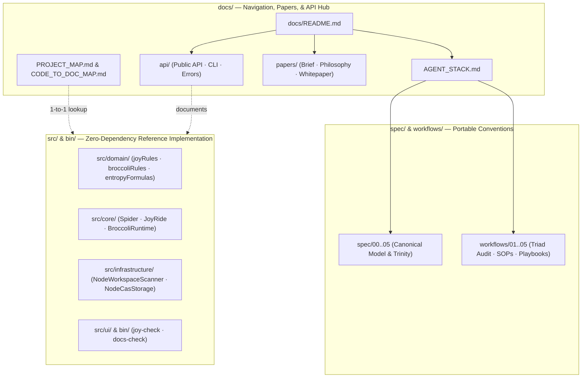

<!-- [LAYER: UI] -->
# HEAV3NS-JOY Documentation

Documentation for the **HEAV3NS-JOY** agnostic, agent-native software development framework (`src/`, `bin/`, `spec/`, `workflows/`). Static architectural conventions live in [`spec/`](../spec/00-CANONICAL-MODEL.md) and [`workflows/`](../workflows/01-TRIAD-AUDIT-PLANNING.md); operational runtime and programmatic touchpoints are indexed here and linked across via [AGENT_STACK.md](AGENT_STACK.md).

<p align="center">
  <a href="papers/companion-brief.md">Companion brief</a> ·
  <a href="AGENT_STACK.md">Agent stack</a> ·
  <a href="PROJECT_MAP.md">Project map</a> ·
  <a href="CODE_TO_DOC_MAP.md">Code ↔ docs</a> ·
  <a href="MAINTAINER.md">Maintainer</a> ·
  <a href="../README.md">Repository README</a>
</p>

---

## Table of contents

- [At a glance](#at-a-glance)
- [How HEAV3NS-JOY differs](#how-heav3ns-joy-differs)
- [Project configuration](#project-configuration)
- [Start here](#start-here)
- [Reading paths by audience](#reading-paths-by-audience)
- [Where to document what](#where-to-document-what)
- [Release & policy](#release--policy)
- [Specifications & workflows](#specifications--workflows)
- [Architecture & internals](#architecture--internals)
- [Papers](#papers)
- [Runtime & Programmatic API](#runtime--programmatic-api)
- [Local development](#local-development)
- [Principles](#principles)

---

## At a glance

Workspace-verified figures from [papers/companion-brief.md](papers/companion-brief.md) (`v1.0.0`):

| Metric | Value | Source |
|--------|-------|--------|
| Package version | **1.0.0** | [`package.json`](../package.json) |
| External npm dependencies | **0** | [`package.json`](../package.json) |
| Canonical architectural zones | **5** | `CANONICAL_ZONES` in [`src/domain/joyRules.mjs`](../src/domain/joyRules.mjs) |
| Frozen public API exports | **84** | [`src/index.mjs`](../src/index.mjs) |
| JoyRide bounded cache tiers | **5** | `JOYRIDE_KINDS` in [`src/core/JoyRideCache.mjs`](../src/core/JoyRideCache.mjs) |
| BroccoliDB runtime modes | **6** | `RUNTIME_MODES` in [`src/domain/broccoliRules.mjs`](../src/domain/broccoliRules.mjs) |
| CLI output formats (`--format`) | **10** | [`bin/joy-check.mjs`](../bin/joy-check.mjs) |
| Automated verification suites | **22** | [`tests/`](../tests/joyzoning.test.mjs) |

## How HEAV3NS-JOY differs

| Typical agent harness / linter | HEAV3NS-JOY |
|--------------------------------|-------------|
| Locked to a specific IDE, model router, or MCP server | Repository-distributed convention + zero-dependency CLI & ESM API |
| Flat lint rules blind to architectural boundaries | 5-zone Sovereign Dependency Matrix (`DOMAIN`, `CORE`, `INFRASTRUCTURE`, `PLUMBING`, `UI`) |
| Unbounded context reads & stale cache reuse | **JoyRide** 11-point fingerprint cache + AST skeletonization (`65%–85%` token reduction) |
| Unverified file writes & opaque session history | **BroccoliDB** Proof-Before-Mutation (`RTG-003`), sharded SHA-256 CAS, and causal `replay()` |



---

## Project configuration

| File / directory | Doc |
|------------------|-----|
| `AGENTS.md` | [60-Second Agent Acquisition Protocol](../AGENTS.md) |
| `stability.config.json` | [Enforcement & Leniency](../spec/04-ENFORCEMENT-AND-LENIENCY.md) · [`configs/stability.config.json`](../configs/stability.config.json) |
| `spider.spec.json` | [Adopting in Existing Projects](../workflows/03-ADOPTING-IN-EXISTING-PROJECTS.md) · [`configs/spider.spec.json`](../configs/spider.spec.json) |
| `.joyignore` | [CLI Reference (`--init`)](api/cli.md) |
| `.broccolidb/storage/` | [Portable Substrate Trinity (CAS & Snapshots)](../spec/05-PORTABLE-SUBSTRATE-TRINITY.md#broccolidb-cas) |

---

## Start here

New? Follow the [Getting Started tutorial](GETTING_STARTED.md); unfamiliar term? See the [Glossary](GLOSSARY.md). To wire this into pipelines, see [CI & Tooling Integration](CI_INTEGRATION.md); to ship a version, see [Releasing](RELEASING.md).

| Doc | Description |
|-----|-------------|
| [Repository README](../README.md) | 5-question operational entrypoint & 60-second quick reference card |
| [Agent Acquisition Protocol](../AGENTS.md) | Direct operational rules and self-check rubric for coding agents |
| [Companion brief](papers/companion-brief.md) | Executive summary & workspace-verified metrics |
| [Agent stack](AGENT_STACK.md) | Two-layer map: Static Joyzoning + Portable Operational Trinity |
| [Project map](PROJECT_MAP.md) | 1-to-1 map of `src/`, `bin/`, `spec/`, `workflows/`, and `tests/` |
| [Code ↔ docs](CODE_TO_DOC_MAP.md) | Source path → documentation page lookup |
| [Maintainer guide](MAINTAINER.md) | Doc CI guardrails (`npm run docs:check`) and update checklist |

---

## Reading paths by audience

| Audience | Recommended path | Time |
|----------|------------------|------|
| **Coding agent (immediate task)** | [`AGENTS.md`](../AGENTS.md) → [`spec/00-CANONICAL-MODEL.md`](../spec/00-CANONICAL-MODEL.md) → [`workflows/02-TACTICAL-REFACTORING-SOPS.md`](../workflows/02-TACTICAL-REFACTORING-SOPS.md) | ~5 min |
| **New adopter (brownfield repo)** | [`workflows/03-ADOPTING-IN-EXISTING-PROJECTS.md`](../workflows/03-ADOPTING-IN-EXISTING-PROJECTS.md) → [CLI Reference](api/cli.md) → [`examples/typescript/`](../examples/typescript/violations-and-fixes.md) | ~15 min |
| **Team lead / evaluator** | [Companion brief](papers/companion-brief.md) → [Validation report](../VALIDATION_REPORT.md) → [Constitution](CONSTITUTION.md) | ~15 min |
| **Architect / theorist** | [Philosophy](papers/philosophy.md) → [Metrics & Forensics](../spec/03-METRICS-AND-FORENSICS.md) → [Whitepaper](papers/whitepaper.md) | ~35 min |
| **Substrate integrator** | [Agent stack](AGENT_STACK.md) → [Public API](api/public-api.md) → [Portable Substrate Trinity](../spec/05-PORTABLE-SUBSTRATE-TRINITY.md) | ~30 min |
| **Doc / core contributor** | [MAINTAINER](MAINTAINER.md) → [DOCS_GUIDE](DOCS_GUIDE.md) → [CODE_TO_DOC_MAP](CODE_TO_DOC_MAP.md) | ~10 min |

---

## Where to document what

| Change | Update in `docs/` | Update in `spec/` or `workflows/` |
|--------|-------------------|-----------------------------------|
| New exported function/class in `src/index.mjs` | `api/public-api.md`, `CODE_TO_DOC_MAP.md`, `papers/companion-brief.md` | — |
| New CLI flag or output format in `bin/joy-check.mjs` | `api/cli.md`, `README.md`, `papers/companion-brief.md` | — |
| New `SPI-xxx` or `RTG-xxx` diagnostic code | `api/errors.md` | `spec/03-METRICS-AND-FORENSICS.md` or `spec/05-PORTABLE-SUBSTRATE-TRINITY.md` |
| New refactoring SOP or agent playbook | `CODE_TO_DOC_MAP.md` | `workflows/02-TACTICAL-REFACTORING-SOPS.md` or `workflows/05-PORTABLE-SPIDER-AND-BROCCOLIDB.md` |
| New module added under `src/` | `PROJECT_MAP.md`, `CODE_TO_DOC_MAP.md`, `architecture/current.md` | — |

---

## Release & policy

| Doc | Purpose |
|-----|---------|
| [MAINTAINER.md](MAINTAINER.md) | When to update docs; CI commands (`npm run docs:check`); link & metric guardrails |
| [DOCS_GUIDE.md](DOCS_GUIDE.md) | Complete documentation map and structural principles |
| [CONSTITUTION.md](CONSTITUTION.md) | The 5 immutable laws of the HEAV3NS-JOY substrate |
| [CODEBASE_STANDARDS.md](CODEBASE_STANDARDS.md) | Repository layout, 5-zone discipline, and AI-friendly codebase rules |
| [VALIDATION_REPORT.md](../VALIDATION_REPORT.md) | Self-conformance dogfood metrics & clean-room acquisition findings |

---

## Specifications & workflows

| Topic | Doc |
|-------|-----|
| Canonical 5-Zone Model | [`spec/00-CANONICAL-MODEL.md`](../spec/00-CANONICAL-MODEL.md) |
| Syntax & Header Placement | [`spec/01-SYNTAX-AND-HEADERS.md`](../spec/01-SYNTAX-AND-HEADERS.md) |
| Dependency & Composition Rules | [`spec/02-DEPENDENCY-AND-COMPOSITION-RULES.md`](../spec/02-DEPENDENCY-AND-COMPOSITION-RULES.md) |
| Spider Metrics & Forensics (`SPI-101..403`) | [`spec/03-METRICS-AND-FORENSICS.md`](../spec/03-METRICS-AND-FORENSICS.md) |
| Enforcement Themes & Escape Hatches | [`spec/04-ENFORCEMENT-AND-LENIENCY.md`](../spec/04-ENFORCEMENT-AND-LENIENCY.md) |
| Portable Substrate Trinity (JoyRide, Spider, BroccoliDB) | [`spec/05-PORTABLE-SUBSTRATE-TRINITY.md`](../spec/05-PORTABLE-SUBSTRATE-TRINITY.md) |
| Triad Audit Planning | [`workflows/01-TRIAD-AUDIT-PLANNING.md`](../workflows/01-TRIAD-AUDIT-PLANNING.md) |
| 9 Tactical Refactoring SOPs | [`workflows/02-TACTICAL-REFACTORING-SOPS.md`](../workflows/02-TACTICAL-REFACTORING-SOPS.md) |
| Brownfield Adoption Playbook | [`workflows/03-ADOPTING-IN-EXISTING-PROJECTS.md`](../workflows/03-ADOPTING-IN-EXISTING-PROJECTS.md) |
| JoyRide Execution Caching Ergonomics | [`workflows/04-EXECUTION-ERGONOMICS-JOYRIDE.md`](../workflows/04-EXECUTION-ERGONOMICS-JOYRIDE.md) |
| Spider & BroccoliDB Operational Playbook | [`workflows/05-PORTABLE-SPIDER-AND-BROCCOLIDB.md`](../workflows/05-PORTABLE-SPIDER-AND-BROCCOLIDB.md) |

---

## Architecture & internals

| Doc | Description |
|-----|-------------|
| [Agent stack](AGENT_STACK.md) | Two-layer map (Static Joyzoning + Operational Substrate Trinity) |
| [Architecture (current)](architecture/current.md) | 5-zone module structure, execution flow, and polyglot scanner pipeline |
| [Project map](PROJECT_MAP.md) | 1-to-1 directory and file guide across the repository |
| [Code-to-doc map](CODE_TO_DOC_MAP.md) | Source file → documentation page index |
| [Constitution](CONSTITUTION.md) | Sovereign laws of Domain purity, Contractual Identity, and Proof-Before-Mutation |

---

## Papers

| Doc | Audience | Purpose |
|-----|----------|---------|
| [Index](papers/README.md) | All | Reading order and verification commands |
| [Companion brief](papers/companion-brief.md) | Leads, evaluators | Executive summary · workspace-verified metrics |
| [Philosophy](papers/philosophy.md) | Builders, architects | Sovereign agency · spatial zoning · proof before mutation |
| [Whitepaper](papers/whitepaper.md) | Engineers | Full mathematical and architectural treatment |

---

## Runtime & Programmatic API

| Doc | Topic |
|-----|-------|
| [api/README.md](api/README.md) | API & CLI documentation index |
| [api/public-api.md](api/public-api.md) | Frozen 84-symbol programmatic export surface (`src/index.mjs`) |
| [api/cli.md](api/cli.md) | `bin/joy-check.mjs` & `bin/docs-check.mjs` CLI reference |
| [api/errors.md](api/errors.md) | Typed `GuidedError` catalog + `SPI-*` and `RTG-*` diagnostics |

---

## Local development

**Run full verification & documentation guardrails (repository root):**

```bash
npm test                            # Run all 22 test suites + CLI smoke tests (node:test)
npm run joy-check                   # Strict self-hosting Joyzoning & Spider audit
npm run docs:check                  # Verify required docs, relative links, sections, and live metrics
node ./bin/joy-check.mjs . --doctor # Run StabilityDoctor architectural health checkup
node ./bin/joy-check.mjs . --stats  # Run V215 multivariate workspace statistics & Z-score outliers
```

---

## Principles

1. **1-to-1 with code** — Every architecture table and API page mirrors real files under `src/`, `bin/`, `spec/`, and `workflows/`.
2. **Zero external dependencies** — Both the runtime substrate and documentation verifiers use only standard Node.js built-ins.
3. **Two-layer clarity** — Spatial conventions (`spec/`, `workflows/`) and operational substrate APIs (`docs/api/`) are cleanly indexed without duplication.
4. **Measured claims** — All metrics in `docs/README.md` and `docs/papers/companion-brief.md` are verified against live source files by `npm run docs:check`.
