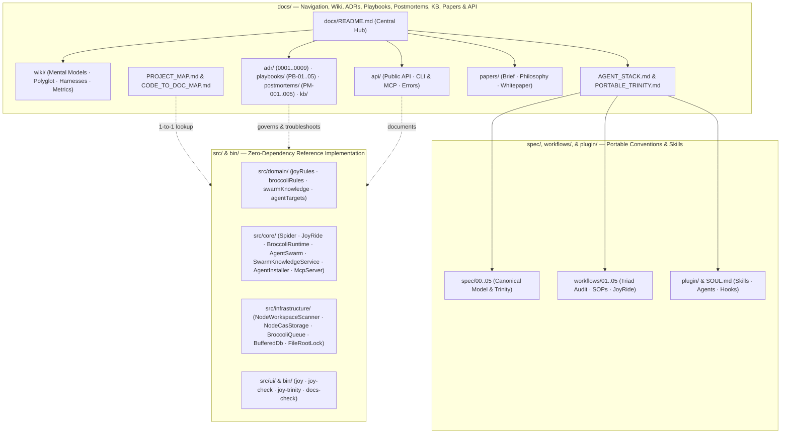

<!-- [LAYER: UI] -->
# HEAV3NS-JOY Documentation

Documentation for the **HEAV3NS-JOY** agnostic, agent-native software development framework (`src/`, `bin/`, `spec/`, `workflows/`). Organized using the **Diátaxis + Institutional Memory** architecture ([ADR-0009](adr/0009-diataxis-documentation-and-knowledge-governance.md)): Tutorials, Operational Playbooks, Normative Specifications & API Reference, Concept Wiki & Papers, Architecture Decision Records (ADRs), Blameless Postmortems, and a 3-Tier Knowledge Base.

<p align="center">
  <a href="GETTING_STARTED.md">Getting Started</a> ·
  <a href="wiki/README.md">Wiki</a> ·
  <a href="adr/README.md">ADRs</a> ·
  <a href="playbooks/README.md">Playbooks</a> ·
  <a href="postmortems/README.md">Postmortems</a> ·
  <a href="kb/README.md">Knowledge Base</a> ·
  <a href="api/README.md">API & CLI</a> ·
  <a href="papers/companion-brief.md">Papers</a> ·
  <a href="../README.md">Repository README</a>
</p>

---

## Table of contents

- [At a glance](#at-a-glance)
- [Documentation architecture (Diátaxis + Institutional Memory)](#documentation-architecture-diátaxis--institutional-memory)
- [How HEAV3NS-JOY differs](#how-heav3ns-joy-differs)
- [Project configuration](#project-configuration)
- [Start here](#start-here)
- [Reading paths by audience](#reading-paths-by-audience)
- [ADRs, Playbooks, Wiki, Postmortems, & Knowledge Base](#adrs-playbooks-wiki-postmortems--knowledge-base)
- [Where to document what](#where-to-document-what)
- [Release & policy](#release--policy)
- [Specifications & workflows](#specifications--workflows)
- [Architecture & internals](#architecture--internals)
- [Papers](#papers)
- [Runtime & Programmatic API](#runtime--programmatic-api)
- [Local development](#local-development)
- [Principles](#principles)

---

## At a glance

Workspace-verified figures from [papers/companion-brief.md](papers/companion-brief.md) (`v1.0.0`):

| Metric | Value | Source |
|--------|-------|--------|
| Package version | **1.0.0** | [`package.json`](../package.json) |
| External npm dependencies | **0** | [`package.json`](../package.json) |
| Canonical architectural zones | **5** | `CANONICAL_ZONES` in [`src/domain/joyRules.mjs`](../src/domain/joyRules.mjs) |
| Frozen public API exports | **84** | [`src/index.mjs`](../src/index.mjs) |
| Portable Trinity & Agent exports | **23** | [`src/portable.mjs`](../src/portable.mjs) (`heav3ns-joy/portable`) |
| Native agent installer targets | **8** | `claude`, `gemini`, `antigravity`, `cursor`, `copilot`, `windsurf`, `codex`, `cline` in [`src/domain/agentTargets.mjs`](../src/domain/agentTargets.mjs) |
| Stdio MCP server surface | **23** tools · **5** resources · **3** prompts | [`src/core/McpServer.mjs`](../src/core/McpServer.mjs) (`joy mcp`) |
| JoyRide bounded cache tiers | **5** | `JOYRIDE_KINDS` in [`src/core/JoyRideCache.mjs`](../src/core/JoyRideCache.mjs) |
| BroccoliDB runtime modes | **6** | `RUNTIME_MODES` in [`src/domain/broccoliRules.mjs`](../src/domain/broccoliRules.mjs) |
| CLI output formats (`--format`) | **10** | [`bin/joy-check.mjs`](../bin/joy-check.mjs) |
| Architecture Decision Records (ADRs) | **9** + template | [`docs/adr/README.md`](adr/README.md) |
| Operational Playbooks & SOP Workflows | **5** playbooks · **5** workflows | [`docs/playbooks/README.md`](playbooks/README.md) · [`workflows/`](../workflows/01-TRIAD-AUDIT-PLANNING.md) |
| Blameless Engineering Postmortems | **5** + template | [`docs/postmortems/README.md`](postmortems/README.md) |
| Automated verification suites | **36** (`196`+ tests across `22` files) | [`tests/`](../tests/joyzoning.test.mjs) |

---

## Documentation architecture (Diátaxis + Institutional Memory)

Modeled on industry-standard engineering portals (**Stripe Docs**, **Backstage TechDocs**, **Google SRE Runbooks & Blameless Postmortems**, and **MADR**):

| Quadrant / Pillar | Purpose | Entry Hub |
| :--- | :--- | :--- |
| **1. Tutorials (Learning)** | Hands-on 10-minute onboarding from first audit to green CI | [Getting Started](GETTING_STARTED.md) |
| **2. Playbooks & Workflows (Task / Incident)** | Step-by-step incident triage (`PB-01..05`) & refactoring SOPs (`workflows/01..05`) | [Playbooks Hub](playbooks/README.md) · [Operations Runbook](OPERATIONS.md) |
| **3. Reference (Information)** | Normative specs (`spec/00..05`), CLI flags, MCP tools, 84-export API, error catalog | [API & CLI Hub](api/README.md) · [Canonical Model](../spec/00-CANONICAL-MODEL.md) |
| **4. Wiki & Papers (Explanation)** | Mental models, polyglot cookbook, agent harness guide, entropy math, whitepaper | [Engineering Wiki](wiki/README.md) · [Papers Hub](papers/README.md) |
| **5. ADRs (Decision Provenance)** | Immutable MADR records (`ADR-0001..0009`) explaining *why* every architecture choice was made | [ADR Registry](adr/README.md) |
| **6. Postmortems (Reliability Memory)** | Blameless SRE postmortems (`PM-001..005`) linking failure modes to code guards & tests | [Postmortems Hub](postmortems/README.md) |
| **7. Knowledge Base (Symptom & Heuristic Memory)** | Symptom-to-fix matrix, technical FAQ, & 3-tier runtime/repo knowledge handling (`SwarmKnowledgeService`) | [Knowledge Base Hub](kb/README.md) |

---

## How HEAV3NS-JOY differs

| Typical agent harness / linter | HEAV3NS-JOY |
|--------------------------------|-------------|
| Locked to a specific IDE, model router, or MCP server | Repository-distributed convention (`AGENTS.md`, `SOUL.md`) + `joy init` 8-agent installer + zero-dependency CLI, MCP server, & ESM API |
| Flat lint rules blind to architectural boundaries | 5-zone Sovereign Dependency Matrix (`DOMAIN`, `CORE`, `INFRASTRUCTURE`, `PLUMBING`, `UI`) ([ADR-0001](adr/0001-five-canonical-zones-and-geographic-alignment.md)) |
| Unbounded context reads & stale cache reuse | **JoyRide** 11-point fingerprint cache + AST skeletonization (`65%–85%` token reduction) ([ADR-0005](adr/0005-joyride-eleven-point-fingerprint-cache.md)) |
| Unverified file writes & opaque session history | **BroccoliDB** Proof-Before-Mutation (`RTG-003`), sharded SHA-256 CAS, and causal `replay()` ([ADR-0004](adr/0004-proof-before-mutation-and-sharded-cas.md)) |
| Queue, database, and swarm locked inside a proprietary host | **Portable Broccoli Trinity** (`BroccoliQueue`, `BufferedDb`, `AgentSwarm`) operable from any shell via `joy-trinity` or `joy mcp` ([ADR-0006](adr/0006-portable-trinity-and-shell-json-contract.md)) |
| Ephemeral agent notes that either vanish or leak secrets | **3-Tier Knowledge-Based Handling**: `JoyRideCache` → `SwarmKnowledgeService` (`store`/`recall`/`search`/`prune`) → CI-verified `docs/kb/`, `docs/adr/`, `docs/playbooks/`, & `docs/postmortems/` ([Knowledge Architecture](kb/knowledge-handling-architecture.md)) |



---

## Project configuration

| File / directory | Doc |
|------------------|-----|
| `AGENTS.md` | [60-Second Agent Acquisition Protocol](../AGENTS.md) |
| `SOUL.md` | [Operating Principles & Agent Constitution](../SOUL.md) |
| `.joy/install.json` | [Native Agent Installer Manifest (`joy init` / `joy status`)](api/cli.md) |
| `.joy-state/` | [Portable Broccoli Trinity State Directory (`joy-trinity`)](PORTABLE_TRINITY.md) |
| `stability.config.json` | [Enforcement & Leniency](../spec/04-ENFORCEMENT-AND-LENIENCY.md) · [`configs/stability.config.json`](../configs/stability.config.json) |
| `spider.spec.json` | [Adopting in Existing Projects](../workflows/03-ADOPTING-IN-EXISTING-PROJECTS.md) · [`configs/spider.spec.json`](../configs/spider.spec.json) |
| `.joyignore` | [CLI Reference (`--init`)](api/cli.md) |
| `.broccolidb/storage/` | [Portable Substrate Trinity (CAS & Snapshots)](../spec/05-PORTABLE-SUBSTRATE-TRINITY.md#broccolidb-cas) |

---

## Start here

New? Follow the [Getting Started tutorial](GETTING_STARTED.md) or browse the [Engineering Wiki](wiki/README.md); unfamiliar term? See the [Glossary](GLOSSARY.md). Hitting an error code or operational issue? Jump to the [Knowledge Base & Symptom Matrix](kb/README.md) or [Operational Playbooks](playbooks/README.md). Curious *why* a rule or subsystem was designed this way? Read the [Architecture Decision Records (ADRs)](adr/README.md) and [Blameless Postmortems](postmortems/README.md). To wire this into pipelines, see [CI & Tooling Integration](CI_INTEGRATION.md); to ship a version, see [Releasing](RELEASING.md). Spreading it to a team or agents? See [Propagation](PROPAGATION.md). Embedding the zero-dependency BroccoliQueue, BufferedDb, and AgentSwarm? See [Portable Broccoli Trinity](PORTABLE_TRINITY.md). Running it in production pipelines? Use the [Operations Runbook](OPERATIONS.md).

| Doc | Description |
|-----|-------------|
| [Repository README](../README.md) | 5-question operational entrypoint & 60-second quick reference card |
| [Agent Acquisition Protocol](../AGENTS.md) | Direct operational rules and self-check rubric for coding agents |
| [Engineering Wiki](wiki/README.md) | Visual mental models, polyglot recipes, agent harnesses, & entropy math encyclopedia |
| [ADR Registry](adr/README.md) | MADR Architecture Decision Records (`ADR-0001..0009`) with live verification |
| [Operational Playbooks](playbooks/README.md) | Incident & operational runbooks (`PB-01..05`) with decision trees |
| [Blameless Postmortems](postmortems/README.md) | Incident postmortems (`PM-001..005`) linked to code invariants & regression suites |
| [Knowledge Base Hub](kb/README.md) | 3-Tier Knowledge-Based Handling architecture, symptom diagnosis matrix, & deep FAQ |
| [Companion brief](papers/companion-brief.md) | Executive summary & workspace-verified metrics |
| [Agent stack](AGENT_STACK.md) | Three-surface map: Static Joyzoning + Portable Operational Trinity + Native Agent Tooling |
| [Project map](PROJECT_MAP.md) | 1-to-1 map of `src/`, `bin/`, `spec/`, `workflows/`, `docs/`, and `tests/` |
| [Code ↔ docs](CODE_TO_DOC_MAP.md) | Source path → documentation page lookup |
| [Maintainer guide](MAINTAINER.md) | Doc CI guardrails (`npm run docs:check`) and update checklist |

---

## Reading paths by audience

| Audience | Recommended path | Time |
|----------|------------------|------|
| **Coding agent (immediate task)** | [`AGENTS.md`](../AGENTS.md) → [`SOUL.md`](../SOUL.md) → [Symptom Matrix](kb/symptom-diagnosis-matrix.md) → [Playbook PB-01](playbooks/architectural-violation-remediation.md) | ~5 min |
| **New adopter (brownfield repo)** | [Mental Models](wiki/mental-models.md) → [Playbook PB-05 (Brownfield Rollout)](playbooks/brownfield-migration-and-monorepo-rollout.md) → [Polyglot Cookbook](wiki/polyglot-recipes.md) | ~15 min |
| **On-call operator / SRE** | [Operations Runbook](OPERATIONS.md) → [Operational Playbooks (`PB-01..05`)](playbooks/README.md) → [Blameless Postmortems (`PM-001..005`)](postmortems/README.md) | ~15 min |
| **Team lead / evaluator** | [Companion brief](papers/companion-brief.md) → [ADR Registry (`ADR-0001..0009`)](adr/README.md) → [Validation report](../VALIDATION_REPORT.md) | ~15 min |
| **Architect / theorist** | [Philosophy](papers/philosophy.md) → [Metrics Encyclopedia](wiki/metrics-and-entropy-encyclopedia.md) → [Whitepaper](papers/whitepaper.md) | ~35 min |
| **Substrate / swarm integrator** | [Agent stack](AGENT_STACK.md) → [Knowledge-Based Handling](kb/knowledge-handling-architecture.md) → [Portable Trinity](PORTABLE_TRINITY.md) | ~25 min |
| **Doc / core contributor** | [MAINTAINER](MAINTAINER.md) → [DOCS_GUIDE](DOCS_GUIDE.md) → [CODE_TO_DOC_MAP](CODE_TO_DOC_MAP.md) | ~10 min |

---

## ADRs, Playbooks, Wiki, Postmortems, & Knowledge Base

### 1. Architecture Decision Records ([`docs/adr/`](adr/README.md))

| ADR | Decision |
| :--- | :--- |
| [ADR-0001](adr/0001-five-canonical-zones-and-geographic-alignment.md) | Five Canonical Zones (`DOMAIN`, `CORE`, `INFRASTRUCTURE`, `PLUMBING`, `UI`) & Principle of Geographic Alignment |
| [ADR-0002](adr/0002-zero-dependency-polyglot-lexical-scanner.md) | Zero External Dependencies & Single-Pass Polyglot Lexical Scanner |
| [ADR-0003](adr/0003-strike-one-vs-advisory-enforcement-model.md) | Strike-1 Blocking vs. Non-Blocking Advisory Enforcement (`SPI-*` Taxonomy) |
| [ADR-0004](adr/0004-proof-before-mutation-and-sharded-cas.md) | Proof-Before-Mutation (`RTG-003`), Causal `RuntimeStateGraph`, & Sharded SHA-256 CAS |
| [ADR-0005](adr/0005-joyride-eleven-point-fingerprint-cache.md) | JoyRide 5-Tier Cache, 11-Point Fingerprint Validation, & L1/L2 CAS Spillover |
| [ADR-0006](adr/0006-portable-trinity-and-shell-json-contract.md) | Portable Broccoli Trinity & Harness-Agnostic Shell-In/JSON-Out Contract |
| [ADR-0007](adr/0007-dual-composition-roots-and-frozen-api.md) | Dual Composition Roots (`src/index.mjs` Frozen 84-Export Surface & `src/portable.mjs`) |
| [ADR-0008](adr/0008-non-destructive-agent-installer-and-safe-mcp.md) | Non-Destructive 8-Agent Installer (`joy init`), Managed Blocks, & RCE-Free Stdio MCP |
| [ADR-0009](adr/0009-diataxis-documentation-and-knowledge-governance.md) | Diátaxis + Institutional Memory Documentation Architecture & Automated Guardrails |

### 2. Operational & Incident Playbooks ([`docs/playbooks/`](playbooks/README.md))

| Playbook | Scenario |
| :--- | :--- |
| [PB-01: Architectural Violation Remediation](playbooks/architectural-violation-remediation.md) | Fixing `SPI-201` cycles, `SPI-205` plumbing state, `SPI-206` layer/I/O leaks, `SPI-208` headers, `SPI-209` import depth, & `SPI-401..403` |
| [PB-02: Trinity Lock, WAL, Queue, & CAS Recovery](playbooks/trinity-lock-and-wal-recovery.md) | Resolving `ROOT_LOCKED` (`.joy-lock`), `BUFFER_FULL`, failed `BroccoliQueue` jobs, & `CAS_CORRUPTION_QUARANTINED` |
| [PB-03: Specialist Swarm Stalls & Failover](playbooks/swarm-stalls-and-failover.md) | Recovering `stale` specialist claims, cascading dependency skips (`swarm retry`), & `FORMATION_INCOMPLETE` |
| [PB-04: Agent Drift & MCP Troubleshooting](playbooks/agent-drift-and-mcp-troubleshooting.md) | Handling `CONFLICTS` (`.joy/backup/`), `joy status` drift, `joy mcp` stdio checks, & `joy hook post-edit` |
| [PB-05: Brownfield Migration & Monorepo Rollout](playbooks/brownfield-migration-and-monorepo-rollout.md) | 4-phase rollout (`--init` → `spider.spec.json` → `--theme relaxed` → `--theme strict`) across legacy & monorepo projects |

### 3. Engineering Wiki ([`docs/wiki/`](wiki/README.md))

| Wiki Page | Topic |
| :--- | :--- |
| [Mental Models & Visual Analogies](wiki/mental-models.md) | The Five-Room Restaurant, Producer-Before-Consumer Wavefront, Strike-1 vs Advisory, Merkle Shield, Proof-Before-Mutation, Untrusted Blackboard |
| [Polyglot Joyzoning Cookbook](wiki/polyglot-recipes.md) | Header syntax, `I<ClassName>` Dependency Inversion, and alias resolution for TS/JS, Python, Go, Rust, Java, C/C++, SQL, & Markdown |
| [Agent Harnesses, Skills, Hooks, & MCP](wiki/mcp-and-agent-harnesses.md) | Deep dive into `joy init` across all 8 coding agents, `AGENTS.md` + `SOUL.md`, CLI vs MCP vs ESM, and post-edit hooks |
| [Metrics & Entropy Math Encyclopedia](wiki/metrics-and-entropy-encyclopedia.md) | Visual guide to 5-Factor Entropy ($E_S$), Stability Index ($SI$), Martin's Main Sequence ($I, A, D'$), Gini Hubbiness, Tarjan Bridges (`SPI-207`), & Ghost Coupling (`SPI-108`) |

### 4. Blameless Engineering Postmortems ([`docs/postmortems/`](postmortems/README.md))

| Postmortem | Incident & Architectural Lesson |
| :--- | :--- |
| [PM-001: Agent Infinite Repair Loop on Advisories](postmortems/PM-001-agent-infinite-repair-loop-on-advisory-warnings.md) | Why topological/complexity telemetry (`SPI-207`, `SPI-105`) must never exit `1` ([ADR-0003](adr/0003-strike-one-vs-advisory-enforcement-model.md)) |
| [PM-002: Multi-Process WAL Contention & Orphaned Locks](postmortems/PM-002-multi-process-wal-contention-and-orphaned-root-locks.md) | Atomic `FileRootLock` (`wx`), same-host dead-PID reclamation, & signal-safe shutdown ([ADR-0006](adr/0006-portable-trinity-and-shell-json-contract.md)) |
| [PM-003: Template-Literal False Imports & BOM Headers](postmortems/PM-003-template-literal-false-positive-imports-and-bom-headers.md) | Stateful `${...}` brace-tracking lexer in `codeTokenizer.mjs` & UTF-8 BOM stripping ([ADR-0002](adr/0002-zero-dependency-polyglot-lexical-scanner.md)) |
| [PM-004: Cache Poisoning & Secret Leakage in Scratchpads](postmortems/PM-004-cache-poisoning-and-secret-leakage-in-agent-scratchpads.md) | 11-point fingerprint validation, `SECRET_DETECTED` guard, & `SPI-006` Merkle Reality Shield ([ADR-0005](adr/0005-joyride-eleven-point-fingerprint-cache.md)) |
| [PM-005: Prompt Injection & Unverified Swarm Replay](postmortems/PM-005-prompt-injection-and-unverified-replay-in-specialist-swarms.md) | Shell-free `ProcessAgentEngine`, provable `safeToRetry` failover, & `<workspace_heuristics trust="untrusted">` ([ADR-0006](adr/0006-portable-trinity-and-shell-json-contract.md)) |

### 5. Knowledge Base & Knowledge-Based Handling ([`docs/kb/`](kb/README.md))

| KB Article | Focus |
| :--- | :--- |
| [Knowledge-Based Handling Architecture](kb/knowledge-handling-architecture.md) | 3-Tier Knowledge Lifecycle (`JoyRideCache` → `SwarmKnowledgeService` `store`/`recall`/`search`/`prune` → Institutional Docs) |
| [Symptom & Diagnostic Code Matrix](kb/symptom-diagnosis-matrix.md) | Complete Symptom → Root Cause → One-Line Fix Command → Playbook/ADR lookup table |
| [Deep Technical FAQ & Edge Cases](kb/faq-and-edge-cases.md) | `import type`, Composition Roots, `[LAYER: UTILS]`, `@joyzoning-bypass`, heuristic rejection reasons, & air-gapped CI |

---

## Where to document what

| Change | Update in `docs/` | Update in `spec/` or `workflows/` |
|--------|-------------------|-----------------------------------|
| New architectural decision or trade-off | `adr/NNNN-*.md`, `adr/README.md`, `DOCS_GUIDE.md` | — |
| New operational failure mode or incident | `postmortems/PM-*.md`, `playbooks/PB-*.md`, `kb/symptom-diagnosis-matrix.md` | — |
| New exported function/class in `src/index.mjs` or `src/portable.mjs` | `api/public-api.md`, `PORTABLE_TRINITY.md`, `CODE_TO_DOC_MAP.md`, `papers/companion-brief.md` | — |
| New CLI command/flag or MCP tool in `bin/joy*.mjs` or `McpServer.mjs` | `api/cli.md`, `README.md`, `papers/companion-brief.md`, `kb/symptom-diagnosis-matrix.md` | — |
| New `SPI-xxx` or `RTG-xxx` diagnostic code | `api/errors.md`, `kb/symptom-diagnosis-matrix.md`, `wiki/metrics-and-entropy-encyclopedia.md` | `spec/03-METRICS-AND-FORENSICS.md` or `spec/05-PORTABLE-SUBSTRATE-TRINITY.md` |
| New refactoring SOP or agent playbook | `playbooks/README.md`, `CODE_TO_DOC_MAP.md` | `workflows/02-TACTICAL-REFACTORING-SOPS.md` or `workflows/05-PORTABLE-SPIDER-AND-BROCCOLIDB.md` |
| New module added under `src/`, `bin/`, or `plugin/` | `PROJECT_MAP.md`, `CODE_TO_DOC_MAP.md`, `architecture/current.md` | — |

---

## Release & policy

| Doc | Purpose |
|-----|---------|
| [MAINTAINER.md](MAINTAINER.md) | When to update docs; CI commands (`npm run docs:check`); link, taxonomy, & metric guardrails |
| [DOCS_GUIDE.md](DOCS_GUIDE.md) | Complete documentation map and Diátaxis + Institutional Memory structural principles |
| [CONSTITUTION.md](CONSTITUTION.md) | The 5 immutable laws of the HEAV3NS-JOY substrate |
| [CODEBASE_STANDARDS.md](CODEBASE_STANDARDS.md) | Repository layout, 5-zone discipline, and AI-friendly codebase rules |
| [SECURITY_BEST_PRACTICES.md](SECURITY_BEST_PRACTICES.md) | Security model, CAS & `.joy-lock` guards, MCP confinement, and untrusted heuristic framing |
| [RELEASING.md](RELEASING.md) | Versioning rules and release procedure |
| [VALIDATION_REPORT.md](../VALIDATION_REPORT.md) | Self-conformance dogfood metrics & clean-room acquisition findings |

---

## Specifications & workflows

| Topic | Doc |
|-------|-----|
| Canonical 5-Zone Model | [`spec/00-CANONICAL-MODEL.md`](../spec/00-CANONICAL-MODEL.md) |
| Syntax & Header Placement | [`spec/01-SYNTAX-AND-HEADERS.md`](../spec/01-SYNTAX-AND-HEADERS.md) |
| Dependency & Composition Rules | [`spec/02-DEPENDENCY-AND-COMPOSITION-RULES.md`](../spec/02-DEPENDENCY-AND-COMPOSITION-RULES.md) |
| Spider Metrics & Forensics (`SPI-101..403`) | [`spec/03-METRICS-AND-FORENSICS.md`](../spec/03-METRICS-AND-FORENSICS.md) |
| Enforcement Themes & Escape Hatches | [`spec/04-ENFORCEMENT-AND-LENIENCY.md`](../spec/04-ENFORCEMENT-AND-LENIENCY.md) |
| Portable Substrate Trinity (JoyRide, Spider, BroccoliDB) | [`spec/05-PORTABLE-SUBSTRATE-TRINITY.md`](../spec/05-PORTABLE-SUBSTRATE-TRINITY.md) |
| Triad Audit Planning | [`workflows/01-TRIAD-AUDIT-PLANNING.md`](../workflows/01-TRIAD-AUDIT-PLANNING.md) |
| 9 Tactical Refactoring SOPs | [`workflows/02-TACTICAL-REFACTORING-SOPS.md`](../workflows/02-TACTICAL-REFACTORING-SOPS.md) |
| Brownfield Adoption Playbook | [`workflows/03-ADOPTING-IN-EXISTING-PROJECTS.md`](../workflows/03-ADOPTING-IN-EXISTING-PROJECTS.md) |
| JoyRide Execution Caching Ergonomics | [`workflows/04-EXECUTION-ERGONOMICS-JOYRIDE.md`](../workflows/04-EXECUTION-ERGONOMICS-JOYRIDE.md) |
| Spider & BroccoliDB Operational Playbook | [`workflows/05-PORTABLE-SPIDER-AND-BROCCOLIDB.md`](../workflows/05-PORTABLE-SPIDER-AND-BROCCOLIDB.md) |

---

## Architecture & internals

| Doc | Description |
|-----|-------------|
| [Agent stack](AGENT_STACK.md) | Three-surface map (Spatial Joyzoning + Operational Substrate + Native Agent Tooling) |
| [Architecture (current)](architecture/current.md) | 5-zone module structure, execution flow, and polyglot scanner pipeline |
| [ADR Registry](adr/README.md) | Architectural decisions (`ADR-0001..0009`) with considered options & verification |
| [Project map](PROJECT_MAP.md) | 1-to-1 directory and file guide across the repository |
| [Code-to-doc map](CODE_TO_DOC_MAP.md) | Source file → documentation page index |
| [Constitution](CONSTITUTION.md) | Sovereign laws of Domain purity, Contractual Identity, and Proof-Before-Mutation |

---

## Papers

| Doc | Audience | Purpose |
|-----|----------|---------|
| [Index](papers/README.md) | All | Reading order and verification commands |
| [Companion brief](papers/companion-brief.md) | Leads, evaluators | Executive summary · workspace-verified metrics |
| [Philosophy](papers/philosophy.md) | Builders, architects | Sovereign agency · spatial zoning · proof before mutation |
| [Whitepaper](papers/whitepaper.md) | Engineers | Full mathematical and architectural treatment |

---

## Runtime & Programmatic API

| Doc | Topic |
|-----|-------|
| [api/README.md](api/README.md) | API & CLI documentation index |
| [api/public-api.md](api/public-api.md) | Frozen 84-symbol programmatic export surface (`src/index.mjs`) + `heav3ns-joy/portable` |
| [api/cli.md](api/cli.md) | `bin/joy.mjs`, `bin/joy-check.mjs`, `bin/joy-trinity.mjs`, `bin/docs-check.mjs`, & MCP server reference |
| [api/errors.md](api/errors.md) | Typed `GuidedError` catalog + `SPI-*` and `RTG-*` diagnostics |
| [PORTABLE_TRINITY.md](PORTABLE_TRINITY.md) | Zero-dependency `BroccoliQueue`, `BufferedDb`, and `AgentSwarm` shell & Node API guide |
| [Knowledge-Based Handling](kb/knowledge-handling-architecture.md) | `SwarmKnowledgeService` (`store`, `recall`, `search`, `prune`), `JoyRideCache`, & 3-tier memory guide |

---

## Local development

**Run full verification & documentation guardrails (repository root):**

```bash
npm run verify                      # Run tests + joy-check + docs:check + plugin:check
npm test                            # Run all 22 test files
npm run joy-check                   # Strict self-hosting Joyzoning & Spider audit
npm run docs:check                  # Verify required docs, ADRs/Playbooks/Wiki/Postmortems/KB, links, & live metrics
npm run plugin:check                # Verify generated plugin/ bundle is in sync with templates
node ./bin/joy.mjs doctor .         # Verify Node, Trinity selftest, agent installation, & live MCP handshake
node ./bin/joy-check.mjs . --doctor # Run StabilityDoctor architectural health checkup
node ./bin/joy-check.mjs . --stats  # Run V215 multivariate workspace statistics & Z-score outliers
```

---

## Principles

1. **1-to-1 with code** — Every architecture table, ADR, Playbook, Postmortem, and API page mirrors real files under `src/`, `bin/`, `spec/`, and `workflows/`.
2. **Zero external dependencies** — Both the runtime substrate and documentation verifiers use only standard Node.js built-ins.
3. **Diátaxis + Institutional Memory clarity** — Normative specifications (`spec/`, `workflows/`), operational runbooks (`docs/playbooks/`), decision records (`docs/adr/`), blameless postmortems (`docs/postmortems/`), concept wiki (`docs/wiki/`), and symptom KB (`docs/kb/`) each have a dedicated home without duplication.
4. **Measured claims** — All metrics, required sections, hub indexes, and relative links across every `.md` file are verified against live source files by `npm run docs:check`.
