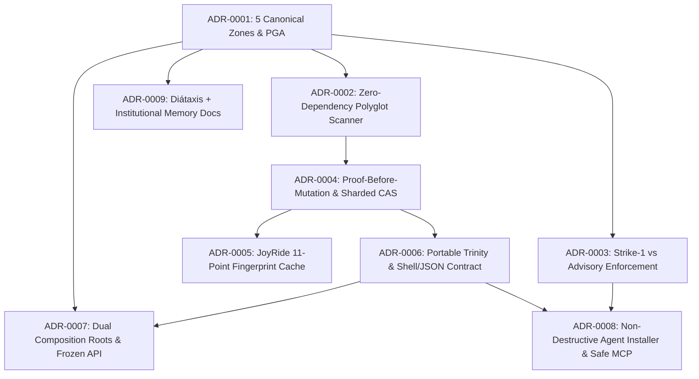

<!-- [LAYER: UI] -->
# Architecture Decision Records (ADRs)

  <a href="../README.md">Docs Hub</a> ·
  <a href="../wiki/README.md">Wiki</a> ·
  <a href="../playbooks/README.md">Playbooks</a> ·
  <a href="../postmortems/README.md">Postmortems</a> ·
  <a href="../kb/README.md">Knowledge Base</a> ·
  <a href="../architecture/current.md">Architecture</a> ·
  <a href="../CONSTITUTION.md">Constitution</a>

An **Architecture Decision Record (ADR)** captures a significant architectural choice in **HEAV3NS-JOY**, its context, the alternatives evaluated, its consequences, and the **executable verification commands** (`joy-check`, `docs-check`, or test suites) that keep the decision continuously enforced in the codebase.

Our ADR format follows **MADR (Markdown Any Decision Records)** and **Michael Nygard's canonical ADR discipline**, extended with an explicit `## Verification` section so no ADR ever degrades into unverified prose.

---

## Decision dependency graph

---

## Canonical ADR index

| ADR | Title | Status | Surface | Enforced By |
| :--- | :--- | :---: | :--- | :--- |
| [Template](0000-adr-template.md) | Canonical MADR Template for HEAV3NS-JOY | Template | Governance | [`bin/docs-check.mjs`](../../bin/docs-check.mjs) |
| [ADR-0001](0001-five-canonical-zones-and-geographic-alignment.md) | Five Canonical Zones & Principle of Geographic Alignment (PGA) | **Accepted** | Spatial Architecture | [`src/domain/joyRules.mjs`](../../src/domain/joyRules.mjs) (`SPI-205..209`) |
| [ADR-0002](0002-zero-dependency-polyglot-lexical-scanner.md) | Zero External Dependencies & Single-Pass Polyglot Lexical Scanner | **Accepted** |Plumbing & Scanner | [`src/plumbing/codeTokenizer.mjs`](../../src/plumbing/codeTokenizer.mjs), [`tests/portable-portability.test.mjs`](../../tests/portable-portability.test.mjs) |
| [ADR-0003](0003-strike-one-vs-advisory-enforcement-model.md) | Strike-1 Blocking vs. Non-Blocking Advisory Enforcement | **Accepted** | Spider Forensics | [`src/core/SpiderEngine.mjs`](../../src/core/SpiderEngine.mjs), [`spec/04-ENFORCEMENT-AND-LENIENCY.md`](../../spec/04-ENFORCEMENT-AND-LENIENCY.md) |
| [ADR-0004](0004-proof-before-mutation-and-sharded-cas.md) | Proof-Before-Mutation (`RTG-003`), Causal Graph, & Sharded SHA-256 CAS | **Accepted** | Operational Substrate | [`src/core/BroccoliRuntime.mjs`](../../src/core/BroccoliRuntime.mjs), [`src/infrastructure/NodeCasStorage.mjs`](../../src/infrastructure/NodeCasStorage.mjs) |
| [ADR-0005](0005-joyride-eleven-point-fingerprint-cache.md) | JoyRide 5-Tier Cache, 11-Point Fingerprint Validation, & L1/L2 CAS Spillover | **Accepted** | Operational Substrate | [`src/core/JoyRideCache.mjs`](../../src/core/JoyRideCache.mjs) |
| [ADR-0006](0006-portable-trinity-and-shell-json-contract.md) | Portable Broccoli Trinity & Harness-Agnostic Shell-In/JSON-Out Contract | **Accepted** | Portable Trinity | [`bin/joy-trinity.mjs`](../../bin/joy-trinity.mjs), [`src/infrastructure/FileRootLock.mjs`](../../src/infrastructure/FileRootLock.mjs) |
| [ADR-0007](0007-dual-composition-roots-and-frozen-api.md) | Dual Composition Roots (`src/index.mjs` Frozen 84-Export Surface & `src/portable.mjs`) | **Accepted** | Programmatic API | [`src/index.mjs`](../../src/index.mjs), [`src/portable.mjs`](../../src/portable.mjs) |
| [ADR-0008](0008-non-destructive-agent-installer-and-safe-mcp.md) | Non-Destructive 8-Agent Installer (`joy init`), Managed Blocks, & RCE-Free Stdio MCP | **Accepted** | Native Agent Tooling | [`src/core/AgentInstaller.mjs`](../../src/core/AgentInstaller.mjs), [`src/core/McpServer.mjs`](../../src/core/McpServer.mjs) |
| [ADR-0009](0009-diataxis-documentation-and-knowledge-governance.md) | Diátaxis + Institutional Memory Documentation Architecture & Automated Guardrails | **Accepted** | Documentation & KB | [`src/core/SpiderToolkit.mjs`](../../src/core/SpiderToolkit.mjs), [`bin/docs-check.mjs`](../../bin/docs-check.mjs) |

---

## ADR lifecycle & governance rules

1. **Immutability after acceptance**: Once an ADR is marked **Accepted**, its core decision is historical record. If requirements evolve, create a new ADR and update the prior ADR's status to `Superseded by [ADR-XXXX](...)`.
2. **Required sections**: Every numbered ADR (`0001-*.md` and above) must include:
   - `## Status`
   - `## Context`
   - `## Decision`
   - `## Consequences`
   - `## Verification`
3. **Closed-loop traceability**:
   - When an incident in [`docs/postmortems/`](../postmortems/README.md) reveals an architectural gap, the resulting design change is recorded here as an ADR.
   - When an ADR introduces new operational behavior or failure modes, a matching runbook is added to [`docs/playbooks/`](../playbooks/README.md) and indexed in [`docs/kb/`](../kb/README.md).
4. **Automated guardrail**: `npm run docs:check` (`verifyWorkspaceDocs`) verifies that every ADR in `docs/adr/` starts with `<!-- [LAYER: UI] -->`, contains all required sections, is indexed in `docs/adr/README.md`, and has zero broken links.

---

## How to propose a new ADR

1. Copy [`0000-adr-template.md`](0000-adr-template.md) to `docs/adr/NNNN-short-imperative-noun-phrase.md`.
2. Perform a [Triad Audit](../../workflows/01-TRIAD-AUDIT-PLANNING.md) (Architect, Critic, SRE) across the considered options.
3. Add the new ADR to the index table in this file and to `REQUIRED_WORKSPACE_DOCS` in [`src/core/SpiderToolkit.mjs`](../../src/core/SpiderToolkit.mjs).
4. Run `npm run verify` to confirm all links, headers, and tests pass.

