<!-- [LAYER: UI] -->
# HEAV3NS-JOY Knowledge Base & Knowledge-Based Handling Hub

  <a href="../README.md">Docs Hub</a> ·
  <a href="../adr/README.md">ADRs</a> ·
  <a href="../playbooks/README.md">Playbooks</a> ·
  <a href="../wiki/README.md">Wiki</a> ·
  <a href="../postmortems/README.md">Postmortems</a> ·
  <a href="../api/errors.md">Error Catalog</a> ·
  <a href="../GLOSSARY.md">Glossary</a>

Welcome to the **HEAV3NS-JOY Knowledge Base (`docs/kb/`)**—the central hub for **Knowledge-Based Handling**, symptom-first troubleshooting, diagnostic code lookups, and technical FAQs.

In **HEAV3NS-JOY**, knowledge is not static prose: it operates as a **3-Tier Knowledge Lifecycle** connecting ephemeral session caches (`JoyRideCache`, `RuntimeStateGraph`), durable workspace heuristic memory (`SwarmKnowledgeService` / `joy-trinity swarm knowledge`), and verified institutional repository documentation (`docs/kb/`, `docs/adr/`, `docs/playbooks/`, `docs/postmortems/`).

---

## 3-Tier Knowledge Lifecycle

```mermaid
flowchart LR
  subgraph T1 ["Tier 1: Session Memory (Ephemeral / CAS)"]
    JR["JoyRideCache (5 Tiers, 11-Point Fingerprint)"]
    RTG["BroccoliRuntime (Causal DAG, story, explainNode)"]
  end

  subgraph T2 ["Tier 2: Workspace Heuristics (Durable 30-Day TTL)"]
    SK["SwarmKnowledgeService (BufferedDb: agent_knowledge)"]
    CLI["joy-trinity swarm knowledge<br/>store | recall | search | prune"]
  end

  subgraph T3 ["Tier 3: Institutional Knowledge (Git-Versioned & Verified)"]
    KB["docs/kb/ (Symptom Matrix & FAQ)"]
    PB["docs/playbooks/ (PB-01..05 Runbooks)"]
    ADR["docs/adr/ (ADR-0001..0009)"]
    PM["docs/postmortems/ (PM-001..005)"]
  end

  T1 -->|"Specialist reports Heuristic: <fact>"| T2
  T2 -->|"Recurring pattern / incident ratified"| T3
  T3 -->|"Briefs agents via AGENTS.md, SOUL.md & MCP"| T1
```

---

## Knowledge Base index

| Article | Purpose | Primary Audience |
| :--- | :--- | :--- |
| **[Knowledge-Based Handling Architecture](knowledge-handling-architecture.md)** | Complete specification and CLI/API guide for the 3-Tier Knowledge System (`JoyRideCache`, `SwarmKnowledgeService` `store`/`recall`/`search`/`prune`, secret/credential admission guards, untrusted prompt framing, and knowledge promotion). | Engineers, AI agents, & swarm operators |
| **[Symptom & Diagnostic Code Resolution Matrix](symptom-diagnosis-matrix.md)** | Instant Symptom → Root Cause → One-Line Fix Command → Playbook / ADR lookup table covering every exit code (`0`/`1`/`2`), `SPI-*`, `RTG-*`, `GuidedError`, and Trinity/MCP error code. | On-call operators, CI owners, & coding agents |
| **[Deep Technical FAQ & Edge Cases](faq-and-edge-cases.md)** | Answers to complex edge cases: TypeScript `import type`, barrel files (`index.ts`), monorepos, custom folder mappings, inline escape hatches (`@joyzoning-bypass`), MCP sandboxing, and air-gapped CI. | Adopters, architects, & reviewers |

---

## Quick symptom router (top 10 most common questions)

| What you see | Immediate command | Deep dive |
| :--- | :--- | :--- |
| `SPI-206` Domain I/O or layer leak | `node bin/joy-check.mjs --explain SPI-206` | [Playbook PB-01](../playbooks/architectural-violation-remediation.md) |
| `SPI-201` Circular dependency | `node bin/joy-check.mjs --explain SPI-201` | [Playbook PB-01](../playbooks/architectural-violation-remediation.md) |
| `SPI-208` Missing or misaligned `[LAYER]` header | `node bin/joy-check.mjs . --heal --dry-run` | [Playbook PB-01](../playbooks/architectural-violation-remediation.md) |
| `ROOT_LOCKED` on `joy-trinity` | `node bin/joy-trinity.mjs doctor` | [Playbook PB-02](../playbooks/trinity-lock-and-wal-recovery.md) |
| `BUFFER_FULL` on `joy-trinity db push` | `node bin/joy-trinity.mjs doctor` | [Playbook PB-02](../playbooks/trinity-lock-and-wal-recovery.md) |
| Swarm formation stuck or `FORMATION_INCOMPLETE` | `node bin/joy-trinity.mjs swarm status <id>` | [Playbook PB-03](../playbooks/swarm-stalls-and-failover.md) |
| Store, search, or prune workspace heuristics | `node bin/joy-trinity.mjs swarm knowledge search --cwd . --query "<term>"` | [Knowledge Architecture](knowledge-handling-architecture.md) |
| `CONFLICTS` or `modified` drift in `joy status` | `node bin/joy.mjs update . --force` (backs up to `.joy/backup/`) | [Playbook PB-04](../playbooks/agent-drift-and-mcp-troubleshooting.md) |
| `outside the project directory` in `joy mcp` | Pass relative workspace paths (e.g., `src/index.mjs`) | [Playbook PB-04](../playbooks/agent-drift-and-mcp-troubleshooting.md) |
| Adopting in a legacy repo without renaming folders | `node bin/joy-check.mjs <dir> --init` + map in `stability.config.json` | [Playbook PB-05](../playbooks/brownfield-migration-and-monorepo-rollout.md) |

