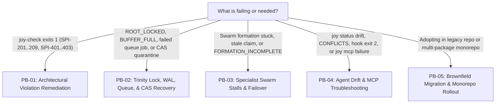

<!-- [LAYER: UI] -->
# Operational & Incident Playbooks

  <a href="../README.md">Docs Hub</a> ·
  <a href="../adr/README.md">ADRs</a> ·
  <a href="../wiki/README.md">Wiki</a> ·
  <a href="../postmortems/README.md">Postmortems</a> ·
  <a href="../kb/README.md">Knowledge Base</a> ·
  <a href="../OPERATIONS.md">Operations Runbook</a> ·
  <a href="../../workflows/02-TACTICAL-REFACTORING-SOPS.md">Refactoring SOPs</a>

Actionable, step-by-step operational playbooks modeled on **Google SRE**, **PagerDuty**, and **Stripe** incident runbooks. Use these playbooks when a CI gate turns red, a `joy-trinity` state directory locks or stalls, an agent setup drifts, or you are rolling out **HEAV3NS-JOY** across a brownfield repository or monorepo.

> [!TIP]
> **Playbooks vs. Workflows**: Normative design workflows live in [`workflows/01..05`](../../workflows/01-TRIAD-AUDIT-PLANNING.md) (`[LAYER: CORE]`). This directory (`docs/playbooks/`) contains **symptom-driven operational & incident response playbooks** with triage cards, Mermaid decision trees, exact CLI commands, and rollback procedures.

---

## Triage router (pick the right playbook in 10 seconds)

---

## Playbook catalog & severity matrix

| ID | Playbook | Severity | Trigger Symptoms / Error Codes | First Command to Run |
| :--- | :--- | :---: | :--- | :--- |
| **[PB-01](architectural-violation-remediation.md)** | [Architectural Violation Remediation](architectural-violation-remediation.md) | `SEV-2` (CI Block) | `SPI-201`, `SPI-205`, `SPI-206`, `SPI-208`, `SPI-209`, `SPI-401..403`, `SPI-006` | `node bin/joy-check.mjs . --format compact` |
| **[PB-02](trinity-lock-and-wal-recovery.md)** | [Trinity Lock, WAL, Queue, & CAS Recovery](trinity-lock-and-wal-recovery.md) | `SEV-1` (State / Queue) | `ROOT_LOCKED`, `BUFFER_FULL`, `CAS_CORRUPTION_QUARANTINED`, failed jobs | `node bin/joy-trinity.mjs doctor` |
| **[PB-03](swarm-stalls-and-failover.md)** | [Specialist Swarm Stalls & Failover](swarm-stalls-and-failover.md) | `SEV-2` (Swarm Stall) | `FORMATION_INCOMPLETE`, `INVALID_REPORT`, `stale` specialist claims, timeouts | `node bin/joy-trinity.mjs swarm status <id>` |
| **[PB-04](agent-drift-and-mcp-troubleshooting.md)** | [Agent Installer Drift & MCP Troubleshooting](agent-drift-and-mcp-troubleshooting.md) | `SEV-3` (Tooling Drift) | `CONFLICTS`, `NOT_INSTALLED`, `modified`/`missing` status, MCP handshake timeout | `node bin/joy.mjs doctor .` |
| **[PB-05](brownfield-migration-and-monorepo-rollout.md)** | [Brownfield Migration & Monorepo Rollout](brownfield-migration-and-monorepo-rollout.md) | `SEV-4` (Planned Rollout) | Thousands of missing headers or non-canonical folders in legacy/monorepo codebase | `node bin/joy-check.mjs <dir> --init --dry-run` |

---

## Standard operating discipline for responders & agents

1. **Diagnose before mutating**: Always run read-only diagnostics (`joy-check --format compact`, `joy-trinity doctor`, `joy status`, `joy-trinity swarm next <id> --peek`) before applying writes.
2. **Use `--dry-run` first**: Both `joy init/update` and `joy-check --init/--heal/--heal-stateless` support `--dry-run`.
3. **Stop after 3 failed attempts**: If an autonomous agent fails to clear the same blocking finding 3 times in a row, it must stop, record a heuristic or report, and escalate rather than weakening `stability.config.json`.
4. **Promote new failure modes**: If an incident is not covered by `PB-01..05`, document the incident in [`docs/postmortems/`](../postmortems/README.md) and update the matching playbook and [`docs/kb/symptom-diagnosis-matrix.md`](../kb/symptom-diagnosis-matrix.md).

