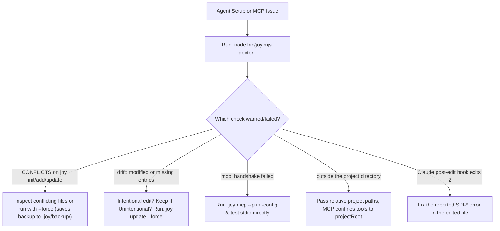

<!-- [LAYER: UI] -->
# Playbook PB-04: Agent Installer Drift (`CONFLICTS`), Hook Blocks, & Stdio MCP Troubleshooting

<p align="center">
  <a href="README.md">Playbooks Hub</a> ·
  <a href="../README.md">Docs Hub</a> ·
  <a href="../api/cli.md">CLI Reference</a> ·
  <a href="../adr/0008-non-destructive-agent-installer-and-safe-mcp.md">ADR-0008</a> ·
  <a href="../SECURITY_BEST_PRACTICES.md">Security Best Practices</a>
</p>

## Triage at a glance

| Field | Detail |
| :--- | :--- |
| **Playbook ID** | `PB-04` |
| **Severity** | `SEV-3` (Agent Integration / IDE / MCP Tooling Issue) |
| **Trigger Codes** | `CONFLICTS`, `NOT_INSTALLED`, `modified` / `missing` in `joy status`, MCP `-32002` / `-32602`, `joy hook post-edit` exit `2` |
| **Time to Mitigate** | `1–5 minutes` |
| **First Command** | `node bin/joy.mjs doctor .` |
| **Rollback Safety** | All forced overwrites save timestamped backups under `.joy/backup/` |

---

## Diagnostic decision tree



---

## Remediation steps

### Case 1: `CONFLICTS` During `joy init`, `joy add`, or `joy update`

[`AgentInstaller.mjs`](../../src/core/AgentInstaller.mjs) never clobbers pre-existing owned files (such as `.cursor/rules/joyzoning.mdc` or `.claude/skills/joyzoning/SKILL.md`) or damaged managed block markers (`<!-- joy:agents:start -->` without a matching `end` marker).

1. **Preview what conflicts without writing anything**:
   ```bash
   node bin/joy.mjs init . --yes --dry-run
   ```
2. **Replace conflicting files safely (automatically backs up originals to `.joy/backup/`)**:
   ```bash
   node bin/joy.mjs init . --yes --force
   # Or when updating an existing installation:
   node bin/joy.mjs update . --force
   ```

### Case 2: `joy status` Reports `modified` or `missing` Files

1. **Inspect per-file drift against `.joy/install.json`**:
   ```bash
   node bin/joy.mjs status .
   ```
2. **Note on shared files (`AGENTS.md`, `SOUL.md`, `CLAUDE.md`, `GEMINI.md`)**:
   - Content *outside* `<!-- joy:<id>:start --> ... <!-- joy:<id>:end -->` is yours and never triggers drift.
   - `modified` only appears if someone edited *inside* the managed markers or modified a joy-owned skill/rule file.
3. **Restore missing or modified managed blocks/files**:
   ```bash
   node bin/joy.mjs update . --force
   ```

### Case 3: `joy doctor` Reports MCP Handshake Failure

`joy doctor` spawns `node bin/joy.mjs mcp`, sends `initialize`, `notifications/initialized`, and `tools/list`, and verifies that all 23 `joy_*` tools respond within 8 seconds.

1. **Print the exact MCP registration config for your project**:
   ```bash
   node bin/joy.mjs mcp --print-config
   ```
2. **Test the stdio MCP server manually in a terminal**:
   ```bash
   printf '{"jsonrpc":"2.0","id":1,"method":"initialize","params":{"protocolVersion":"2025-06-18","capabilities":{},"clientInfo":{"name":"test","version":"1.0"}}}\n{"jsonrpc":"2.0","id":2,"method":"tools/list"}\n' | node bin/joy.mjs mcp
   ```
3. **If an MCP tool returns `isError: true` with `outside the project directory`**:
   - By design ([`ADR-0008`](../adr/0008-non-destructive-agent-installer-and-safe-mcp.md)), `ProjectPathGuard` confines all MCP tool paths (`dir`, `file`, `scope`, `files`, `cwd`, `root`) to the project root (resolving symlinks). Pass relative paths inside the workspace (e.g., `src/core/SpiderEngine.mjs`).

### Case 4: Claude Code `joy hook post-edit` Exits `2`

When installed with `joy init --hooks`, `.claude/settings.json` runs `joy hook post-edit` after file edits.
- If the hook encounters any internal error (missing file, malformed stdin JSON), it exits `0` silently so it never wedges the agent.
- It exits `2` **only** when the edited file has a real Strike-1 blocking Joyzoning violation (`SPI-201`, `SPI-205`, `SPI-206`, `SPI-208`, `SPI-209`, `SPI-401..403`).
- **Fix**: Follow [Playbook PB-01](architectural-violation-remediation.md) to fix the reported `SPI-*` code on the file printed on stderr.

---

## Verification

```bash
node bin/joy.mjs status .
node bin/joy.mjs doctor .
```

Confirm `joy doctor .` reports `All good.` and exits `0`.

