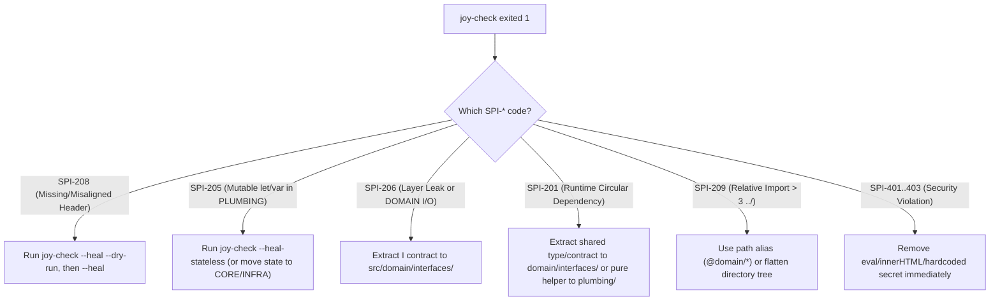

<!-- [LAYER: UI] -->
# Playbook PB-01: Architectural Violation Remediation (`SPI-201..209`, `SPI-401..403`)

<p align="center">
  <a href="README.md">Playbooks Hub</a> ·
  <a href="../README.md">Docs Hub</a> ·
  <a href="../adr/0001-five-canonical-zones-and-geographic-alignment.md">ADR-0001</a> ·
  <a href="../adr/0003-strike-one-vs-advisory-enforcement-model.md">ADR-0003</a> ·
  <a href="../api/errors.md">Error Catalog</a> ·
  <a href="../../workflows/02-TACTICAL-REFACTORING-SOPS.md">9 Tactical SOPs</a>
</p>

## Triage at a glance

| Field | Detail |
| :--- | :--- |
| **Playbook ID** | `PB-01` |
| **Severity** | `SEV-2` (Blocks CI / `joy hook post-edit` exits `2` / `joy-check` exits `1`) |
| **Trigger Codes** | `SPI-201`, `SPI-205`, `SPI-206`, `SPI-208`, `SPI-209`, `SPI-401`, `SPI-402`, `SPI-403`, `SPI-006` |
| **Time to Mitigate** | `1–10 minutes` |
| **First Command** | `node bin/joy-check.mjs . --phase post-edit --scope <changed-file> --format compact` |
| **Rollback Safety** | Read-only audit by default; `--heal` and `--heal-stateless` support `--dry-run` |

---

## Diagnostic decision tree



---

## Remediation steps

### Case 1: `SPI-208` — Missing `[LAYER: <ZONE>]` Header or Geographic Misalignment

1. **Inspect what `--heal` will do without touching disk**:
   ```bash
   node bin/joy-check.mjs . --heal --dry-run
   ```
2. **Apply automatic header alignment** (stamps missing headers or aligns mismatched headers to folder geography while preserving `#!` shebangs and `---` YAML frontmatter):
   ```bash
   node bin/joy-check.mjs . --heal
   ```
3. **If the file is in the wrong physical folder**: Move the file to its canonical folder (`src/domain/`, `src/core/`, `src/infrastructure/`, `src/plumbing/`, `src/ui/`) and preview import rewiring with:
   ```bash
   node -e 'import("./src/index.mjs").then(m => console.log(m.runJoyPlanMove(".", "old/path.mjs", "new/path.mjs")))'
   ```

### Case 2: `SPI-205` — Mutable Top-Level `let` / `var` State in `PLUMBING`

1. **Auto-heal un-reassigned `let`/`var` bindings to `const`**:
   ```bash
   node bin/joy-check.mjs . --heal-stateless --dry-run
   node bin/joy-check.mjs . --heal-stateless
   ```
2. **If the variable is genuinely mutated at runtime** (e.g., an in-memory cache or counter):
   - `PLUMBING` must be 100% stateless. Move stateful coordination classes into `src/core/` (`[LAYER: CORE]`) or concrete I/O caches into `src/infrastructure/` (`[LAYER: INFRASTRUCTURE]`).

### Case 3: `SPI-206` — Axiomatic Layer Leakage or `DOMAIN` I/O Impurity

1. **Run `--explain SPI-206`** to see the exact before/after dependency inversion pattern:
   ```bash
   node bin/joy-check.mjs --explain SPI-206
   ```
2. **Apply the `DECOUPLE` SOP (Producer-Before-Consumer order)**:
   - **If `DOMAIN` imports `node:fs`, `http`, `fetch`, or `INFRASTRUCTURE`**:
     1. Define a pure port contract `src/domain/interfaces/I<Capability>.mjs` (`/** [LAYER: DOMAIN] */`).
     2. Move the `node:fs` / network implementation to `src/infrastructure/<Capability>.mjs` (`/** [LAYER: INFRASTRUCTURE] */`).
     3. Inject the adapter into `CORE` via constructor injection from the Composition Root (`src/index.mjs` or `src/portable.mjs`).
   - **If `UI` imports `INFRASTRUCTURE` directly**:
     - Route the call through a `CORE` controller/service, or register the file in `stability.config.json` `compositionRoots` *only* if it is a true top-level entrypoint (`bin/*.mjs`, `src/index.mjs`).

### Case 4: `SPI-201` — Runtime Circular Dependency (`A -> ... -> A`)

1. **Locate the cycle chain** in the `joy-check` output (`Cycle path: A -> B -> A`).
2. **Break the cycle using one of three strategies**:
   - **Strategy A (Pure Helper Extraction)**: Move the shared stateless function imported by both `A` and `B` into `src/plumbing/<helper>.mjs` (`[LAYER: PLUMBING]`).
   - **Strategy B (Contract Extraction)**: Extract the shared interface/port into `src/domain/interfaces/I<Name>.mjs` (`[LAYER: DOMAIN]`).
   - **Strategy C (Compile-Time Type Import in TypeScript)**: If the back-edge is only used for TypeScript type annotations, change `import { X }` to `import type { X }` (which erases at compile time and downgrades `SPI-201` to non-blocking `SPI-104`).

### Case 5: `SPI-209` — Relative Import Depth Exceeded (`> 3` `../` segments)

1. Replace deep relative traversals (`../../../../domain/Order.mjs`) with configured path aliases (`@domain/Order.mjs`) in `tsconfig.json` / `package.json`, or flatten nested subdirectories so directory depth stays `<= 4`.

### Case 6: `SPI-401..403` — Security Violations

- **`SPI-401` (`eval` / `new Function`)**: Replace dynamic code evaluation with declarative dispatch tables or `JSON.parse`.
- **`SPI-402` (`innerHTML` / `dangerouslySetInnerHTML`)**: Use `textContent` or a dedicated sanitizer.
- **`SPI-403` (Hardcoded Secret / Token)**: Move credentials to environment variables (`process.env.*`) and rotate any exposed key immediately.

---

## Verification

```bash
node bin/joy-check.mjs . --phase post-edit --scope <touched-files> --format compact
node bin/joy-check.mjs . --theme strict
npm test
```

Confirm output reports `Blocking Violations (0): None. 100% Joyzoning Conformance.` and exits `0`.

