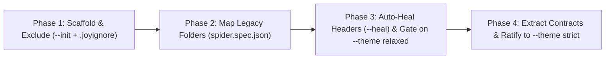

<!-- [LAYER: UI] -->
# Playbook PB-05: Zero-Downtime Brownfield Migration & Polyglot Monorepo Rollout

<p align="center">
  <a href="README.md">Playbooks Hub</a> ·
  <a href="../README.md">Docs Hub</a> ·
  <a href="../../workflows/03-ADOPTING-IN-EXISTING-PROJECTS.md">Brownfield Workflow</a> ·
  <a href="../CI_INTEGRATION.md">CI Integration</a> ·
  <a href="../wiki/polyglot-recipes.md">Polyglot Cookbook</a>
</p>

## Triage at a glance

| Field | Detail |
| :--- | :--- |
| **Playbook ID** | `PB-05` |
| **Severity** | `SEV-4` (Planned Architectural Rollout / Brownfield Ratification) |
| **Trigger Symptoms** | Adopting Joyzoning in an existing repo or monorepo without freezing feature delivery |
| **Time to Mitigate** | `15–30 minutes` for initial CI gate; incremental ratification thereafter |
| **First Command** | `node bin/joy-check.mjs <project-dir> --init --dry-run` |
| **Rollback Safety** | 100% reversible (`git checkout` or `joy remove`); zero runtime dependencies added |

---

## Rollout phases overview



---

## Remediation steps

### Phase 1: Scaffold Configuration & Exclude Generated/Vendored Trees

1. **Scaffold `stability.config.json` and `.joyignore`**:
   ```bash
   node bin/joy-check.mjs <project-dir> --init
   ```
2. **Add generated, vendored, or build output paths to `.joyignore`** so `Files Scanned` reflects only first-party source code:
   ```gitignore
   # [LAYER: INFRASTRUCTURE]
   node_modules/**
   dist/**
   build/**
   coverage/**
   vendor/**
   generated/**
   *.min.js
   *.pb.go
   ```

### Phase 2: Map Existing Brownfield or Monorepo Directories to the 5 Zones

You do **not** need to rename existing directories (`controllers/`, `services/`, `repositories/`, `packages/*/src/`) on day one. Map them in `stability.config.json` (using `*` single-segment or `**` multi-segment wildcards) or `spider.spec.json`:

```json
{
  "version": "1.0.0",
  "theme": "relaxed",
  "layers": {
    "domain": { "paths": ["src/models", "src/entities", "packages/*/src/domain"] },
    "core": { "paths": ["src/usecases", "src/controllers", "packages/*/src/core"] },
    "infrastructure": { "paths": ["src/repositories", "src/adapters", "src/db", "packages/*/src/infrastructure"] },
    "plumbing": { "paths": ["src/utils", "src/helpers", "packages/*/src/plumbing"] },
    "ui": { "paths": ["src/views", "src/components", "src/cli", "packages/*/src/ui"] }
  }
}
```

### Phase 3: Stamp `[LAYER]` Headers & Enable `--theme relaxed` in CI

1. **Preview and apply automatic `[LAYER: <ZONE>]` header stamping and `PLUMBING` statelessness healing**:
   ```bash
   node bin/joy-check.mjs <project-dir> --heal --heal-stateless --dry-run
   node bin/joy-check.mjs <project-dir> --heal --heal-stateless
   ```
2. **Onboard AI coding agents (`AGENTS.md`, `SOUL.md`, skills, MCP)**:
   ```bash
   node bin/joy.mjs init <project-dir> --yes
   ```
3. **Gate CI on `--theme relaxed` first**:
   ```bash
   node bin/joy-check.mjs <project-dir> --theme relaxed
   ```
   Under `relaxed` mode, missing headers (`SPI-208`) and deep relative imports (`SPI-209`) are downgraded to non-blocking warnings, while runtime circular dependencies (`SPI-201`), cross-layer leaks / Domain I/O (`SPI-206`), and security anti-patterns (`SPI-401..403`) immediately block new regressions.

### Phase 4: Ratify Hotspots & Graduate to `--theme strict`

1. **Identify the highest-leverage refactoring targets using `StabilityDoctor`**:
   ```bash
   node bin/joy-check.mjs <project-dir> --doctor
   ```
2. **Resolve remaining `SPI-201` cycles and `SPI-206` leaks** using [Playbook PB-01](architectural-violation-remediation.md) and [`workflows/02-TACTICAL-REFACTORING-SOPS.md`](../../workflows/02-TACTICAL-REFACTORING-SOPS.md).
3. **Flip `"theme": "strict"` in `stability.config.json`** once `node bin/joy-check.mjs <project-dir> --theme strict` exits `0`.

---

## Verification

```bash
node bin/joy-check.mjs <project-dir> --theme strict
node bin/joy.mjs status <project-dir>
```

Confirm `Files Scanned` is non-zero and `Blocking Violations (0): None. 100% Joyzoning Conformance.` is reported.

