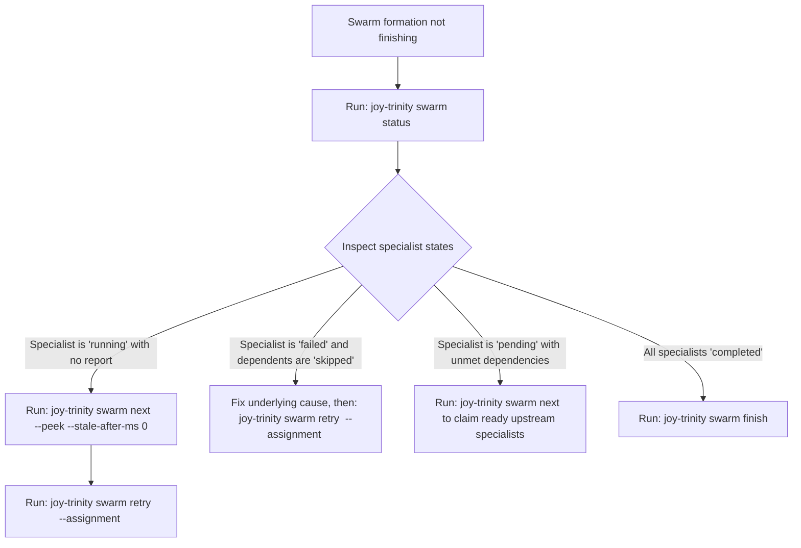

<!-- [LAYER: UI] -->
# Playbook PB-03: Specialist Swarm Stalls, Cascading Skips, & External Process Failover

<p align="center">
  <a href="README.md">Playbooks Hub</a> ·
  <a href="../README.md">Docs Hub</a> ·
  <a href="../PORTABLE_TRINITY.md">Portable Trinity</a> ·
  <a href="../adr/0006-portable-trinity-and-shell-json-contract.md">ADR-0006</a> ·
  <a href="../postmortems/PM-005-prompt-injection-and-unverified-replay-in-specialist-swarms.md">PM-005</a>
</p>

## Triage at a glance

| Field | Detail |
| :--- | :--- |
| **Playbook ID** | `PB-03` |
| **Severity** | `SEV-2` (Multi-Specialist Formation Stalled or Incomplete) |
| **Trigger Codes** | `FORMATION_INCOMPLETE`, `FORMATION_NOT_FOUND`, `INVALID_REPORT`, `INVALID_FORMATION`, `stale` specialist claims |
| **Time to Mitigate** | `1–5 minutes` |
| **First Command** | `node bin/joy-trinity.mjs swarm status <formation-id>` |
| **Rollback Safety** | `swarm next --peek` and `swarm status` are strictly read-only |

---

## Diagnostic decision tree



---

## Remediation steps

### Case 1: A Claimed Specialist Died Without Reporting (`stale` Claim)

When an agent or subagent calls `joy-trinity swarm next <formation-id>`, ready specialists transition from `pending` to `running` (claimed) so concurrent workers never duplicate work. If that subagent crashes or times out before calling `swarm report`:

1. **Inspect without claiming (`--peek`) and detect stale claims**:
   ```bash
   node bin/joy-trinity.mjs swarm next <formation-id> --peek
   # Or force immediate stale detection (default threshold is 30 minutes / 1800000ms):
   node bin/joy-trinity.mjs swarm next <formation-id> --peek --stale-after-ms 0
   ```
2. **Reset the abandoned specialist back to `pending`**:
   ```bash
   node bin/joy-trinity.mjs swarm retry <formation-id> --assignment <specialist-id>
   ```
3. **Claim and execute the specialist again**:
   ```bash
   node bin/joy-trinity.mjs swarm next <formation-id>
   ```

### Case 2: A Failed Specialist Caused Dependents to Become `skipped`

In `SwarmFormationLedger` and `BroccoliTaskDagScheduler`, when an upstream specialist (e.g., `legion_architect`) reports `--status failed`, all downstream dependents (`dependsOn: ["legion_architect"]`) automatically transition to `skipped` so downstream agents never build on broken assumptions.

1. **Inspect the failure reason**:
   ```bash
   node bin/joy-trinity.mjs swarm status <formation-id>
   ```
2. **Reset the failed specialist AND all of its transitive `skipped` dependents in one command**:
   ```bash
   node bin/joy-trinity.mjs swarm retry <formation-id> --assignment <failed-specialist-id>
   ```
3. **Resume the loop** (`swarm next` → `swarm report` → `swarm finish`).

### Case 3: `FORMATION_INCOMPLETE` When Calling `swarm finish`

`swarm finish <formation-id>` refuses to close a formation while any assignment is still `pending` or `running`.
1. Run `node bin/joy-trinity.mjs swarm status <formation-id>` to see which assignments are still open.
2. Either complete them via `swarm next` / `swarm report`, or retry stale/failed assignments via `swarm retry`.

### Case 4: External Process Timeout or Non-Zero Exit in `swarm run --exec`

When using `joy-trinity swarm run --task "<goal>" --exec '["cmd","arg"]'`:
- [`ProcessAgentEngine.mjs`](../../src/infrastructure/ProcessAgentEngine.mjs) passes the prompt via stdin and `$JOY_SWARM_PROMPT_FILE` with **no shell interpolation**.
- If the child process cannot be spawned (`ENOENT` / `EACCES`), `ProcessAgentEngine` marks `safeToRetry: true` so `AgentSwarmDispatcher` can fail over cleanly.
- If the child process runs and exits non-zero or times out (default `--timeout-ms 600000`, escalating `SIGTERM` → `SIGKILL`), it is **never blindly replayed** because the subprocess may have already mutated files on disk ([`PM-005`](../postmortems/PM-005-prompt-injection-and-unverified-replay-in-specialist-swarms.md)).
- **Fix**: Verify the `--exec` binary works standalone (`echo "test" | cmd arg`), check `git status` for partial edits, and increase `--timeout-ms` if needed.

### Case 5: Pruning Old Formations

To keep `.joy-state` lean over time:
```bash
node bin/joy-trinity.mjs swarm prune --older-than-ms 604800000
# To also remove abandoned unfinished formations older than the threshold:
node bin/joy-trinity.mjs swarm prune --older-than-ms 86400000 --include-open
```

---

## Verification

```bash
node bin/joy-trinity.mjs swarm status <formation-id>
node bin/joy-trinity.mjs swarm finish <formation-id>
```

Confirm `swarm finish` returns `"status": "completed"` (or `"partial"` if intentionally closed after terminal failures) and exits `0`.

