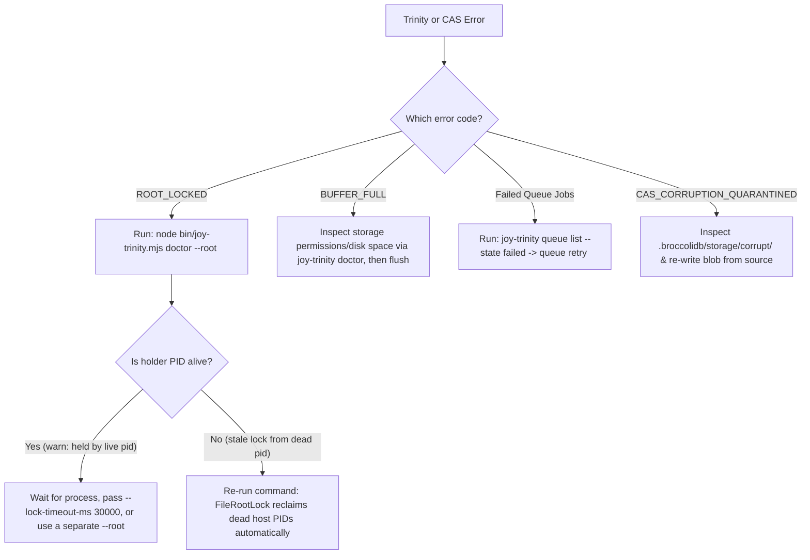

<!-- [LAYER: UI] -->
# Playbook PB-02: Trinity Lock (`ROOT_LOCKED`), WAL, Queue DLQ, & CAS Recovery

<p align="center">
  <a href="README.md">Playbooks Hub</a> ·
  <a href="../README.md">Docs Hub</a> ·
  <a href="../PORTABLE_TRINITY.md">Portable Trinity</a> ·
  <a href="../adr/0004-proof-before-mutation-and-sharded-cas.md">ADR-0004</a> ·
  <a href="../adr/0006-portable-trinity-and-shell-json-contract.md">ADR-0006</a> ·
  <a href="../postmortems/PM-002-multi-process-wal-contention-and-orphaned-root-locks.md">PM-002</a>
</p>

## Triage at a glance

| Field | Detail |
| :--- | :--- |
| **Playbook ID** | `PB-02` |
| **Severity** | `SEV-1` (Stateful Queue / DB / CAS Operation Blocked) |
| **Trigger Codes** | `ROOT_LOCKED`, `BUFFER_FULL`, `CAS_CORRUPTION_QUARANTINED`, `ShadowCommitError`, failed `BroccoliQueue` jobs |
| **Time to Mitigate** | `1–5 minutes` |
| **First Command** | `node bin/joy-trinity.mjs doctor --root ./.joy-state` |
| **Rollback Safety** | `doctor` is non-destructive; dead locks on the same host are reclaimed atomically |

---

## Diagnostic decision tree



---

## Remediation steps

### Case 1: `ROOT_LOCKED` (`.joy-lock` Contention)

Every stateful `joy-trinity` command acquires an exclusive lock file (`.joy-state/.joy-lock`) via [`FileRootLock.mjs`](../../src/infrastructure/FileRootLock.mjs) containing `{ pid, host, token, startedAt }`.

1. **Diagnose the lock holder**:
   ```bash
   node bin/joy-trinity.mjs doctor --root ./.joy-state
   ```
2. **If `doctor` reports `held by live pid <PID>`**:
   - Another `joy-trinity` or `joy mcp` process is currently running against `--root`.
   - Either wait for it to finish, increase the wait window (`--lock-timeout-ms 30000`), or isolate parallel test/agent streams using `--root ./.joy-state-worker-2` (or `$JOY_STATE_ROOT`).
3. **If `doctor` reports `stale lock from a process that no longer exists`**:
   - Simply re-run your `joy-trinity` command. When `holder.host === os.hostname()` and `process.kill(holder.pid, 0)` throws `ESRCH`, `FileRootLock` atomically reclaims the stale lock.
4. **If the stale lock was created inside an ephemeral container with a different hostname**:
   - Verify no container is still mounted to the volume, then remove `.joy-state/.joy-lock` manually.

### Case 2: `BUFFER_FULL` Backpressure in `BufferedDb`

`BufferedDb` holds accepted writes in memory and flushes them in layer-ordered batches to `IBufferedStore`. If the underlying disk/store fails repeatedly, `BufferedDb` retains all uncommitted operations in memory (dropping nothing) until `hardLimitOps` (default `10 × maxBufferedOps`) is reached, at which point new `push` calls fail with `BUFFER_FULL`.

1. **Check disk permissions and SQLite/WAL health**:
   ```bash
   node bin/joy-trinity.mjs doctor --root ./.joy-state
   df -h .
   ```
2. **Fix the underlying filesystem issue** (full disk, read-only mount, or permissions on `.joy-state/.broccolidb`), then call `await db.flush()` (or re-run your `joy-trinity db push` command).

### Case 3: Failed or Stuck `BroccoliQueue` Jobs

1. **Inspect queue counts across all states**:
   ```bash
   node bin/joy-trinity.mjs queue overview
   node bin/joy-trinity.mjs queue list --state failed --limit 20
   ```
2. **Inspect a specific failed job's payload and `lastError`**:
   ```bash
   node bin/joy-trinity.mjs queue get <job-id>
   ```
3. **Retry or cancel the job**:
   ```bash
   node bin/joy-trinity.mjs queue retry <job-id>
   # Or cancel and prune old terminal jobs:
   node bin/joy-trinity.mjs queue cancel <job-id>
   node bin/joy-trinity.mjs queue prune --retention-ms 86400000
   ```

### Case 4: `CAS_CORRUPTION_QUARANTINED` in `NodeCasStorage`

When [`NodeCasStorage.readBlob(hash)`](../../src/infrastructure/NodeCasStorage.mjs) detects that a `.blob` file's actual SHA-256 does not match its filename hash:
1. It automatically moves the damaged file into `.broccolidb/storage/corrupt/<hash>.<timestamp>.corrupt` so it can never poison `JoyRideCache` L2 hydration or `BroccoliRuntime` snapshots.
2. **Recover**: Re-run the audit or session step (`joy-check` or `BroccoliRuntime.snapshot()`) to regenerate and atomically write a fresh CAS blob from live workspace sources.

---

## Verification

```bash
node bin/joy-trinity.mjs doctor --root ./.joy-state
node bin/joy-trinity.mjs selftest
```

Confirm both `doctor` and `selftest` return `"ok": true` and exit `0`.

