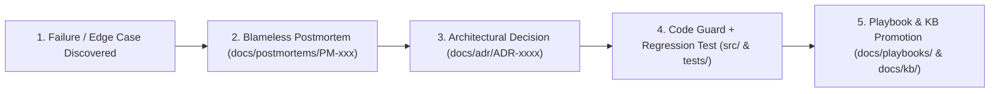

<!-- [LAYER: UI] -->
# Blameless Engineering Postmortems

  <a href="../README.md">Docs Hub</a> ·
  <a href="../adr/README.md">ADRs</a> ·
  <a href="../playbooks/README.md">Playbooks</a> ·
  <a href="../wiki/README.md">Wiki</a> ·
  <a href="../kb/README.md">Knowledge Base</a> ·
  <a href="../OPERATIONS.md">Operations Runbook</a>

In **HEAV3NS-JOY**, every architectural or operational incident is treated as a **system design flaw, never an individual or model failure**. Modeled on **Google SRE**, **Etsy**, and **PagerDuty** blameless postmortem practices, every postmortem in this registry must close the engineering loop by producing:
1. A permanent **code invariant or defense** in `src/`
2. An **automated regression test** in `tests/`
3. A normative **Architecture Decision Record** in [`docs/adr/`](../adr/README.md)
4. An operational **Playbook / Knowledge Base entry** in [`docs/playbooks/`](../playbooks/README.md) and [`docs/kb/`](../kb/README.md)

---

## Closed-loop incident learning pipeline

---

## Postmortem registry

| ID | Incident Title | Severity | Affected Subsystem | Preventative ADR & Test Suite | Status |
| :--- | :--- | :---: | :--- | :--- | :---: |
| [Template](0000-postmortem-template.md) | Canonical Blameless Postmortem Template | Template | All Zones | [`bin/docs-check.mjs`](../../bin/docs-check.mjs) | Active |
| **[PM-001](PM-001-agent-infinite-repair-loop-on-advisory-warnings.md)** | [Autonomous Agent Infinite Repair Loop on Advisory Warnings](PM-001-agent-infinite-repair-loop-on-advisory-warnings.md) | `SEV-1` | `SpiderEngine` / Agent Hooks | [ADR-0003](../adr/0003-strike-one-vs-advisory-enforcement-model.md) · [`tests/joyzoning.test.mjs`](../../tests/joyzoning.test.mjs) | Resolved |
| **[PM-002](PM-002-multi-process-wal-contention-and-orphaned-root-locks.md)** | [Multi-Process WAL Contention & Orphaned `.joy-lock` Deadlocks](PM-002-multi-process-wal-contention-and-orphaned-root-locks.md) | `SEV-1` | `FileRootLock` / `joy-trinity` | [ADR-0006](../adr/0006-portable-trinity-and-shell-json-contract.md) · [`tests/trinity-hardening.test.mjs`](../../tests/trinity-hardening.test.mjs) | Resolved |
| **[PM-003](PM-003-template-literal-false-positive-imports-and-bom-headers.md)** | [Template-Literal False-Positive Imports & UTF-8 BOM Header Blindness](PM-003-template-literal-false-positive-imports-and-bom-headers.md) | `SEV-2` | `codeTokenizer` / `commentStyles` | [ADR-0002](../adr/0002-zero-dependency-polyglot-lexical-scanner.md) · [`tests/joyzoning-advanced.test.mjs`](../../tests/joyzoning-advanced.test.mjs) | Resolved |
| **[PM-004](PM-004-cache-poisoning-and-secret-leakage-in-agent-scratchpads.md)** | [Stale Verification Cache Hallucinations & Secret Leakage in Scratchpads](PM-004-cache-poisoning-and-secret-leakage-in-agent-scratchpads.md) | `SEV-1` | `JoyRideCache` / `SpiderToolkit` | [ADR-0005](../adr/0005-joyride-eleven-point-fingerprint-cache.md) · [`tests/trinity-portability.test.mjs`](../../tests/trinity-portability.test.mjs) | Resolved |
| **[PM-005](PM-005-prompt-injection-and-unverified-replay-in-specialist-swarms.md)** | [Shell Injection, Blind Failover Replay, & Heuristic Poisoning in Swarms](PM-005-prompt-injection-and-unverified-replay-in-specialist-swarms.md) | `SEV-1` | `ProcessAgentEngine` / `SwarmKnowledgeService` | [ADR-0006](../adr/0006-portable-trinity-and-shell-json-contract.md) · [ADR-0008](../adr/0008-non-destructive-agent-installer-and-safe-mcp.md) · [`tests/agentswarm-harnessless.test.mjs`](../../tests/agentswarm-harnessless.test.mjs) | Resolved |

---

## Blameless postmortem standards

1. **No "human error" or "LLM hallucination" as terminal root cause**: If an agent or developer invoked a tool badly or misunderstood a rule, ask *why the CLI, schema, or guardrail allowed or encouraged that failure*.
2. **Required structural sections**: Every `PM-*.md` file is verified by `npm run docs:check` to contain:
   - `## Summary`
   - `## Root cause`
   - `## Action items`
   - `## Lessons learned`
3. **Knowledge Base promotion**: Every resolved postmortem must add or update a symptom row in [`docs/kb/symptom-diagnosis-matrix.md`](../kb/symptom-diagnosis-matrix.md).

