<!-- [LAYER: UI] -->
# HEAV3NS-JOY Engineering Wiki

  <a href="../README.md">Docs Hub</a> ·
  <a href="../adr/README.md">ADRs</a> ·
  <a href="../playbooks/README.md">Playbooks</a> ·
  <a href="../postmortems/README.md">Postmortems</a> ·
  <a href="../kb/README.md">Knowledge Base</a> ·
  <a href="../GETTING_STARTED.md">Getting Started</a> ·
  <a href="../GLOSSARY.md">Glossary</a>

Welcome to the **HEAV3NS-JOY Engineering Wiki**—the visual, concept-first encyclopedia for developers, architects, and autonomous coding agents. While [`spec/`](../../spec/00-CANONICAL-MODEL.md) defines normative specifications and [`docs/api/`](../api/README.md) documents programmatic signatures, this Wiki explains **how everything fits together** through mental models, language recipes, agent integration guides, and visual math walkthroughs.

---

## Visual system map

```mermaid
flowchart LR
  subgraph S1 ["1. Spatial Sovereignty (Joyzoning)"]
    Z["5 Canonical Zones<br/>DOMAIN · CORE · INFRA · PLUMBING · UI"]
    S["Spider Engine<br/>SPI-101..403 & Entropy Math"]
    H["RefactorHealer<br/>--heal & --heal-stateless"]
  end

  subgraph S2 ["2. Portable Operational Substrate"]
    JR["JoyRideCache<br/>11-Point Fingerprint + L2 CAS"]
    BR["BroccoliRuntime<br/>RTG-001..008 Proof-Before-Mutation"]
    TR["Portable Broccoli Trinity<br/>BroccoliQueue · BufferedDb · AgentSwarm"]
  end

  subgraph S3 ["3. Native Agent Tooling"]
    JI["joy init / status / doctor<br/>8 Coding Agent Targets"]
    MCP["joy mcp (Stdio)<br/>23 Tools · 5 Resources · 3 Prompts"]
    KB["3-Tier Knowledge Handling<br/>JoyRide -> SwarmKnowledge -> Docs KB"]
  end

  S1 --> S2 --> S3
```

---

## Wiki encyclopedia chapters

| Chapter | What You Will Learn | Best For |
| :--- | :--- | :--- |
| **[Mental Models & Visual Analogies](mental-models.md)** | The 6 core mental models: *The Five-Room Restaurant*, *Producer-Before-Consumer Wavefront*, *Strike-1 vs. Advisory Telemetry*, *Merkle Reality Shield*, *Proof-Before-Mutation*, and *The Untrusted Blackboard*. | Every human & agent onboarding to HEAV3NS-JOY |
| **[Polyglot Joyzoning Cookbook](polyglot-recipes.md)** | Side-by-side `[LAYER]` header syntax, `I<ClassName>` Dependency Inversion patterns, and alias resolution (`tsconfig.json`, `pyproject.toml`, `go.mod`, `Cargo.toml`) across TypeScript, Python, Go, Rust, Java, C/C++, SQL, and Markdown. | Polyglot developers & brownfield adopters |
| **[Agent Harnesses, Skills, Hooks, & MCP](mcp-and-agent-harnesses.md)** | How `joy init` configures Claude Code, Gemini CLI, Antigravity, Cursor, Copilot, Windsurf, Codex, and Cline; how `SOUL.md` and `AGENTS.md` complement each other; and when to use CLI vs. MCP vs. ESM imports. | AI engineers & IDE workflow builders |
| **[Metrics, Entropy Math, & Forensics Encyclopedia](metrics-and-entropy-encyclopedia.md)** | Intuitive visual guide to Structural Entropy ($E_S$), Stability Index ($SI$), Martin's Main Sequence ($I, A, D'$), Gini Hubbiness, Tarjan Bridges (`SPI-207`), Z-Score Outliers, and Ghost Coupling (`SPI-108`). | Architects, tech leads, & performance reviewers |

---

## Quick navigation by question ("How do I...?")

| Question | Answer |
| :--- | :--- |
| *Why does HEAV3NS-JOY have 5 zones instead of custom layers?* | Read [Mental Models §1](mental-models.md) and [ADR-0001](../adr/0001-five-canonical-zones-and-geographic-alignment.md) |
| *How do I write a Joyzoned module in Python, Go, or Rust?* | Read [Polyglot Joyzoning Cookbook](polyglot-recipes.md) and inspect [`examples/polyglot/`](../../examples/polyglot/go/domain/order.go) |
| *How do I wire Claude Code, Cursor, or Antigravity in one command?* | Read [Agent Harnesses, Skills, Hooks, & MCP](mcp-and-agent-harnesses.md) |
| *What does `Gini Hubbiness: 0.681` or `SPI-207 Tarjan Bridge` mean?* | Read [Metrics & Entropy Encyclopedia](metrics-and-entropy-encyclopedia.md) |
| *How does the swarm remember workspace facts across runs without leaking secrets?* | Read [Knowledge-Based Handling Architecture](../kb/knowledge-handling-architecture.md) |
| *What do I do when a command fails with an error code?* | Open the [Symptom Diagnosis Matrix](../kb/symptom-diagnosis-matrix.md) or [Operational Playbooks](../playbooks/README.md) |

