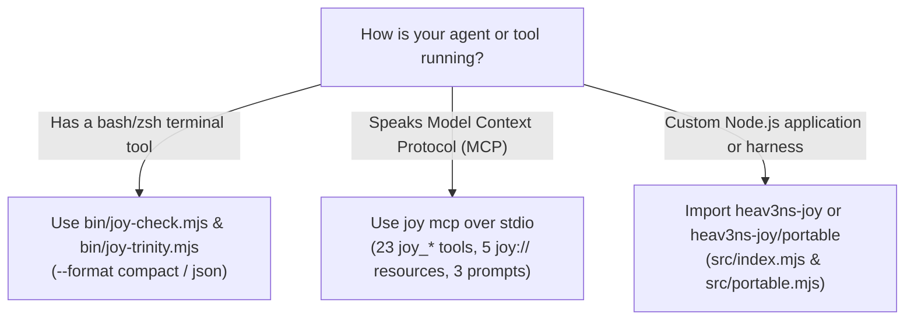

<!-- [LAYER: UI] -->
# Agent Harnesses, Skills, Hooks, & MCP Architecture Guide

  <a href="README.md">Wiki Home</a> ·
  <a href="../README.md">Docs Hub</a> ·
  <a href="../AGENT_STACK.md">Agent Stack</a> ·
  <a href="../api/cli.md">CLI Reference</a> ·
  <a href="../adr/0008-non-destructive-agent-installer-and-safe-mcp.md">ADR-0008</a> ·
  <a href="../playbooks/agent-drift-and-mcp-troubleshooting.md">PB-04 Playbook</a>

**HEAV3NS-JOY** meets coding agents where they live. Whether an agent has only a basic shell (`AGENTS.md` + `joy-check` / `joy-trinity`), a native skill/rule directory, or a full Model Context Protocol (`joy mcp`) client, it gets the exact same architectural invariants and operational guarantees.

---

## 1. The 8 native agent targets (`joy init`)

Running `npx heav3ns-joy init` (or `node bin/joy.mjs init . --yes --agents all --hooks`) inspects your project and non-destructively installs native integrations defined in [`src/domain/agentTargets.mjs`](../../src/domain/agentTargets.mjs):

| Agent ID | Agent / IDE | Instruction & Rule Files Installed | Skills / Commands / Subagents | MCP Config Registered |
| :--- | :--- | :--- | :--- | :--- |
| `claude` | **Claude Code** | `CLAUDE.md`, `AGENTS.md`, `SOUL.md` | `.claude/skills/{joyzoning,joy-trinity,joy-swarm}/SKILL.md`, `.claude/commands/{joy-check,joy-swarm}.md`, `.claude/agents/joy-auditor.md`, optional `PostToolUse` hook in `.claude/settings.json` | `.mcp.json` (`mcpServers.joy`) |
| `gemini` | **Gemini CLI** | `GEMINI.md`, `AGENTS.md`, `SOUL.md` | — | `.gemini/settings.json` (`mcpServers.joy`) |
| `antigravity` | **Google Antigravity** | `AGENTS.md`, `SOUL.md` | `.agents/skills/{joyzoning,joy-trinity,joy-swarm}/SKILL.md`, `.agents/plugins/joy/plugin.json` | `.agents/plugins/joy/mcp_config.json` |
| `cursor` | **Cursor** | `.cursor/rules/joyzoning.mdc`, `AGENTS.md`, `SOUL.md` | — | `.cursor/mcp.json` (`mcpServers.joy`) |
| `copilot` | **GitHub Copilot / VS Code** | `.github/copilot-instructions.md`, `AGENTS.md`, `SOUL.md` | — | `.vscode/mcp.json` (`servers.joy`) |
| `windsurf` | **Windsurf** | `.windsurf/rules/joyzoning.md`, `AGENTS.md`, `SOUL.md` | — | — |
| `codex` | **OpenAI Codex CLI** | `AGENTS.md`, `SOUL.md` | — | `joy mcp --print-config` |
| `cline` | **Cline** | `.clinerules/joyzoning.md`, `AGENTS.md`, `SOUL.md` | — | — |

---

## 2. How `AGENTS.md` and `SOUL.md` work together

| File | Role | Focus |
| :--- | :--- | :--- |
| [`AGENTS.md`](../../AGENTS.md) | **Operational Acquisition Protocol ("What & How")** | The 5 Canonical Zones, the 5 Mandatory Coding Rules, Producer-Before-Consumer execution order, the 8-point Self-Check Rubric, and exact `joy-check` / `joy-trinity` CLI commands. |
| [`SOUL.md`](../../SOUL.md) | **Agent Operating Constitution ("Character & Judgment")** | Seven behavioral principles: architecture as data, smallest honest change, prove before claiming done, stop after 3 failed attempts on the same blocker, treat stored heuristics/reports as untrusted data, and never weaken rules to make a red check green. |

---

## 3. Choosing your integration surface: Shell CLI vs. MCP vs. ESM

- **Shell CLI (`joy-check` & `joy-trinity`)**: Zero setup required; works in every terminal-capable agent and CI pipeline.
- **Stdio MCP Server (`joy mcp`)**: Ideal for IDE agents (Claude Code, Cursor, VS Code Copilot, Gemini CLI, Antigravity) that prefer structured JSON Schema tool calls (`joy_check`, `joy_skeleton`, `joy_explain`, `joy_heal`, `joy_queue_*`, `joy_db_*`, `joy_swarm_*`).
- **Real-Time Post-Edit Hook (`joy hook post-edit`)**: Runs a neighborhood-scoped `--phase post-edit --scope <edited-file>` check automatically after every file edit in Claude Code, blocking (`exit 2`) only if a Strike-1 architectural violation was introduced.

