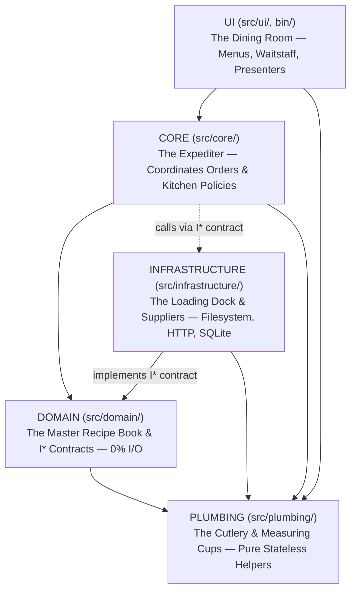
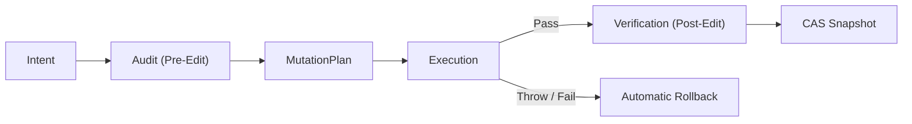

<!-- [LAYER: UI] -->
# Core Mental Models & Visual Analogies

<p align="center">
  <a href="README.md">Wiki Home</a> ·
  <a href="../README.md">Docs Hub</a> ·
  <a href="../adr/README.md">ADRs</a> ·
  <a href="../playbooks/README.md">Playbooks</a> ·
  <a href="../kb/README.md">Knowledge Base</a>
</p>

Six mental models explain the entire **HEAV3NS-JOY** framework. Once you (or an AI agent) internalize these six concepts, every rule in [`spec/`](../../spec/00-CANONICAL-MODEL.md) and every command in [`bin/`](../../bin/joy.mjs) becomes intuitive.

---

## 1. The Five-Room Restaurant (The 5 Canonical Zones)

Think of your codebase as a high-end restaurant with five strictly separated rooms:



- **The Master Recipe Book (`DOMAIN`)** never phones the produce truck (`INFRASTRUCTURE`) mid-recipe (`SPI-206`), and never asks the waiter (`UI`) what color the tablecloth is. It defines pure recipes and formal supplier specifications (`src/domain/interfaces/I*.mjs`).
- **The Dining Room (`UI`)** never walks into the loading dock (`INFRASTRUCTURE`) to grab raw ingredients; it routes every order through **The Expediter (`CORE`)**.
- **The Measuring Cups (`PLUMBING`)** have no memory of what was measured 5 minutes ago (`0` mutable top-level `let`/`var` state, `SPI-205`) and depend on nothing else in the restaurant.

---

## 2. The Producer-Before-Consumer Wavefront

When refactoring or building a feature across multiple files, editing callers before callees causes cascading compiler and linter failures at every intermediate step. HEAV3NS-JOY enforces the **Producer-Before-Consumer Wavefront** ([`workflows/02-TACTICAL-REFACTORING-SOPS.md`](../../workflows/02-TACTICAL-REFACTORING-SOPS.md)):

```
1. PLUMBING (Stateless primitives)
   ↓
2. DOMAIN (I<ClassName> contracts, then pure entities/rules)
   ↓
3. INFRASTRUCTURE (Adapters implementing I<ClassName>)
   ↓
4. CORE (Use-case orchestrators consuming DOMAIN & I<ClassName>)
   ↓
5. UI (CLI / presenters / composition roots wiring INFRA into CORE)
```

At every step of this wavefront, all dependencies of the file you are writing **already exist and pass verification**.

---

## 3. Strike-1 Blocks vs. Advisory Telemetry

Why do autonomous coding agents get stuck in infinite repair loops on traditional linters? Because traditional linters conflate **hard structural corruption** with **soft heuristic smells** ([`PM-001`](../postmortems/PM-001-agent-infinite-repair-loop-on-advisory-warnings.md), [`ADR-0003`](../adr/0003-strike-one-vs-advisory-enforcement-model.md)).

- **Strike-1 Blocking Violations (`exit 1`)**: Runtime circular dependencies (`SPI-201`), mutable plumbing state (`SPI-205`), cross-layer/I/O leaks (`SPI-206`), missing/misaligned headers (`SPI-208`), import depth `> 3` (`SPI-209`), and security vulnerabilities (`SPI-401..403`). These are deterministic, local, and unambiguous to fix.
- **Advisory Telemetry (`[INFO]`, `exit 0`)**: Tarjan bridges (`SPI-207`), cognitive complexity (`SPI-105`), blast radius (`SPI-202`), and Ghost Coupling (`SPI-108`). These guide architectural planning (`--doctor`, `--stats`) without deadlocking day-to-day commits.

---

## 4. The Merkle Reality Shield (`SPI-006`) & AST Skeletons

Agents pay a steep token tax when they read entire 700-line files just to learn a method signature, and they hallucinate when a human or concurrent process edits a file on disk mid-session.
- **AST Skeletonization (`--skeleton <file> --keep-symbol <fn>`)**: Strips function bodies while preserving `[LAYER]` headers, imports, exports, class definitions, and method signatures—reducing token volume by **65%–85%** while keeping the full body of the one method being edited.
- **Merkle Reality Shield (`SPI-006`)**: `computeMerkleRoot` hashes every workspace file with FIPS 180-4 SHA-256. Before `post-edit` verification or mutation, `verifyDiskParity` compares live disk hashes against the baseline, halting immediately if an external process modified a tracked file behind the agent's back.

---

## 5. Proof-Before-Mutation (`RTG-003`)

In [`BroccoliRuntime`](../../src/core/BroccoliRuntime.mjs), no mutation is legal unless causally preceded by a recorded `Audit` and `MutationPlan` ([`ADR-0004`](../adr/0004-proof-before-mutation-and-sharded-cas.md)):



If `Execution` throws, `rollbackFn` fires automatically and records a causal `Rollback` edge in `RuntimeStateGraph`.

---

## 6. The Untrusted Blackboard (`SwarmKnowledgeService`)

When a specialist swarm runs across a repository, specialists discover valuable operational facts (e.g., `Heuristic: run npm run plugin:build after editing src/domain/agentTargets.mjs`).
- **How to share without prompt injection or secret leaks?**
  1. Every `Heuristic: ...` line is screened by [`diagnoseLegionObservation`](../../src/domain/swarmKnowledge.mjs) (rejecting secrets, tokens, URLs with credentials, multiline text, and control characters).
  2. Accepted facts are scoped by the SHA-256 hash of the workspace directory (`legionWorkspaceScope(cwd)`) and stored with a 30-day TTL.
  3. When replayed into future specialist prompts, they are XML-escaped and wrapped inside `<workspace_heuristics trust="untrusted">` with explicit instructions to verify claims against live code ([`PM-005`](../postmortems/PM-005-prompt-injection-and-unverified-replay-in-specialist-swarms.md)).

