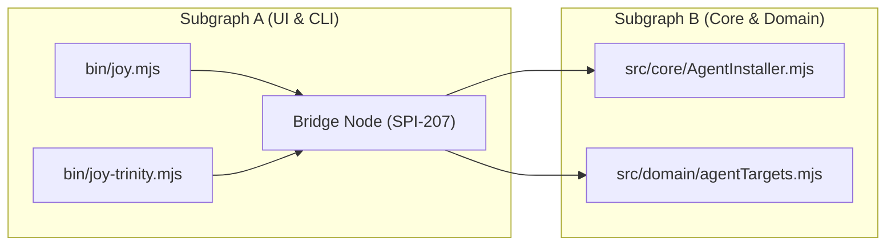

<!-- [LAYER: UI] -->
# Visual Encyclopedia of Spider Metrics, Entropy Math, & Forensics

  <a href="README.md">Wiki Home</a> ·
  <a href="../README.md">Docs Hub</a> ·
  <a href="../../spec/03-METRICS-AND-FORENSICS.md">Spec 03: Metrics</a> ·
  <a href="../papers/whitepaper.md">Technical Whitepaper</a> ·
  <a href="../api/errors.md">Diagnostic Catalog</a>

This page explains the mathematical formulas implemented in [`src/domain/entropyFormulas.mjs`](../../src/domain/entropyFormulas.mjs) and [`src/core/SpiderEngine.mjs`](../../src/core/SpiderEngine.mjs) in plain language, showing how to interpret every number in `joy-check`, `--doctor`, and `--stats`.

---

## 1. Five-Factor Structural Entropy ($E_S$) & Stability Index ($SI$)

Every `joy-check` run computes a composite **Structural Entropy Score ($E_S \in [0, 1]$)** across five weighted pillars, plus an additive cycle penalty:

$$
E_S = \min\left(1.0,\; 0.15 E_{\text{depth}} + 0.20 E_{\text{naming}} + 0.15 E_{\text{orphan}} + 0.30 E_{\text{coupling}} + 0.20 E_{\text{complexity}} + P_{\text{cycles}}\right)
$$

From $E_S$, the **Stability Index ($SI$)** is derived on a $0\%\text{–}100\%$ scale:

$$
SI = \max\left(0,\; \text{round}\left((1 - E_S) \times 100\right)\right)\%
$$

| Pillar | Weight | What It Measures | How to Improve It |
| :--- | :---: | :--- | :--- |
| **$E_{\text{coupling}}$** | `30%` | Ratio of cross-zone violation edges (`SPI-206`) to total dependency edges | Extract `I<Name>` contracts to `src/domain/interfaces/` |
| **$E_{\text{naming}}$** | `20%` | Ratio of files missing `[LAYER]` headers or misaligned with folder geography (`SPI-208`) | Run `joy-check --heal` or move files to matching folders |
| **$E_{\text{complexity}}$** | `20%` | Average cognitive complexity and Fat Module load (`SPI-203`, `SPI-105`) | Apply `DECOMPOSE` SOP to split files `> 800` lines |
| **$E_{\text{depth}}$** | `15%` | Ratio of files exceeding `maxPathDepth` (`4`) or `maxRelativeImportDepth` (`3`, `SPI-209`) | Flatten folder nesting or use path aliases |
| **$E_{\text{orphan}}$** | `15%` | Ratio of non-entrypoint modules with `0` incoming and `0` outgoing edges (`SPI-204`) | Wire or prune dead modules (`PRUNE` SOP) |
| **$P_{\text{cycles}}$** | Additive | $+0.15$ per runtime circular dependency (`SPI-201`), capped at $0.60$ | Break cycles via `domain/interfaces/` or `plumbing/` |

---

## 2. Robert C. Martin's Main Sequence ($I$, $A$, $D'$)

For each zone and module, [`entropyFormulas.mjs`](../../src/domain/entropyFormulas.mjs) computes:
- **Instability ($I$)**: $I = \frac{C_e}{C_a + C_e}$, where $C_a$ is afferent (incoming) coupling and $C_e$ is efferent (outgoing) coupling.
  - $I = 0$: Maximally stable (`PLUMBING` and `DOMAIN` contracts).
  - $I = 1$: Maximally unstable/dependent (`UI` entrypoints and `bin/`).
- **Abstractness ($A$)**: Ratio of abstract contracts/interfaces (`I*`) to total symbols.
- **Normalized Distance from the Main Sequence ($D'$)**:

$$
D' = |A + I - 1|
$$

- **Zone of Pain ($I \approx 0, A \approx 0, D' \to 1$)**: Concrete module heavily depended upon by many callers without an interface contract (`StabilityDoctor` recommends synthesizing `I<ClassName>`).
- **Zone of Uselessness ($I \approx 1, A \approx 1, D' \to 1$)**: Abstract interfaces with zero consumers.

---

## 3. Gini Hubbiness, Tarjan Bridges (`SPI-207`), & Blast Radius (`SPI-202`)

- **Gini Hubbiness Coefficient ($G \in [0, 1]$)**: Measures inequality of incoming dependency edges across the graph. A high Gini ($> 0.70$) means a tiny handful of "god hubs" attract almost all imports.
- **Tarjan Articulation Bridge (`SPI-207`)**: Identified via Tarjan's $O(V + E)$ low-link DFS algorithm. A bridge node is an articulation point whose removal splits a connected component into disjoint subgraphs. `SPI-207` is an informational (`[INFO]`) signal reminding engineers that changes to this file ripple across subgraphs.
- **Blast Radius (`SPI-202`) & Ripple Prophecy (`SPI-300`)**: Transitive reverse-BFS count of all upstream callers affected if a module's contract changes.

---

## 4. Multivariate Z-Score Outliers (`--stats`) & Temporal Ghost Coupling (`SPI-108`)

Run `node bin/joy-check.mjs . --stats` to inspect:
1. **Multivariate Z-Score Outliers ($Z > 2.0\sigma$)**: Computes mean ($\mu$) and standard deviation ($\sigma$) across cognitive complexity, fan-in coupling, and line count, flagging statistical outlier modules ($Z = \frac{x - \mu}{\sigma} > 2.0$) even before they cross hard line caps.
2. **Temporal Ghost Coupling (`SPI-108`)**: Given a sequence of historical Merkle snapshots (`historySnapshots`), [`detectGhostCoupling`](../../src/domain/entropyFormulas.mjs) computes the **Jaccard similarity** $J(A, B) = \frac{|M_A \cap M_B|}{|M_A \cup M_B|}$ of file co-mutations. If two files co-mutate in $\ge 3$ transitions with $J(A, B) \ge 0.75$ despite having **zero import path** between them, `SPI-108` flags hidden implicit coupling (such as duplicated magic constants or unshared schemas).

