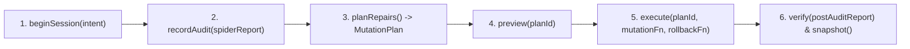

<!-- [LAYER: CORE] -->
# 05 — Operational Playbook: Portable Spider, JoyRide, and BroccoliDB

This workflow defines how coding agents and CI pipelines combine **JoyRide**, **Spider**, and **BroccoliDB** into a zero-dependency, self-verifying execution loop.

---

## 1. Fast Pre-Edit Neighborhood Check & Structural Skeletonization

Before editing a high-coupling module, scope the Spider check to its $N$-hop dependency neighborhood and distill surrounding files into structural skeletons to save 65%–85% context window tokens:

```bash
# 1. Run a pre-edit check scoped to a target file and its 1-hop neighborhood
node ./bin/joy-check.mjs . --phase pre-edit --scope src/core/SpiderEngine.mjs --neighborhood 1 --format compact

# 2. Distill a large file into its structural signature skeleton while keeping the active method body intact
node ./bin/joy-check.mjs . --skeleton src/core/SpiderEngine.mjs --keep-symbol auditProject
```

---

## 2. Governed Proof-Before-Mutation Pipeline (`BroccoliRuntime`)

Never mutate source files during an audit scan. Follow the 6-stage BroccoliDB governed pipeline:



### Programmatic Usage (Zero Dependencies)

```js
import {
  NodeWorkspaceScanner,
  NodeCasStorage,
  SpiderEngine,
  BroccoliRuntime
} from "./src/index.mjs";

const rootDir = ".";
const scanner = new NodeWorkspaceScanner();
const spider = new SpiderEngine(scanner);
const cas = new NodeCasStorage(rootDir);
const runtime = new BroccoliRuntime({ casStorage: cas, mode: "development" });

runtime.start();

// 1. Express Intent
const { sessionId } = runtime.beginSession({
  intent: "Align missing layer headers and verify zero architectural drift"
});

// 2. Spider Proves (Zero Mutation During Audit)
const preReport = spider.auditProject(rootDir);
runtime.recordAudit(sessionId, preReport);

// 3. Plan Repairs (Enforces RTG-003 Proof-Before-Mutation & Mode Budgets)
const plan = runtime.planRepairs(sessionId, preReport);

// 4. Execute with Automatic Rollback Guard
runtime.execute(
  sessionId,
  plan.planId,
  (activePlan) => {
    // Perform bounded repairs for activePlan.directives
    return { healed: activePlan.directives.length };
  },
  {
    rollbackFn: () => {
      // Restore pre-mutation file contents if an error occurs
    }
  }
);

// 5. Post-Mutation Verification & Integrity-Gated Snapshot (RTG-001..008)
const postReport = spider.auditProject(rootDir);
runtime.verify(sessionId, postReport);
const snap = runtime.snapshot(sessionId);

// 6. Causal Story & Forensic Replay
console.log(runtime.story(sessionId));
const replay = runtime.replay(sessionId, {
  mode: "forensic",
  liveGraphHash: snap.graph.graphHash
});
```

---

## 3. CI / IDE Interchange Formats

Integrate `joy-check` into any editor, test harness, or CI runner without external plugins:

```bash
# ESLint / Cargo-style compact lines + remediation playbook
node ./bin/joy-check.mjs . --format compact

# Language Server Protocol (LSP) PublishDiagnostics + CodeAction JSON
node ./bin/joy-check.mjs . --format lsp

# Test Anything Protocol (TAP v13)
node ./bin/joy-check.mjs . --format tap

# JUnit XML for standard CI test reporters
node ./bin/joy-check.mjs . --format junit

# Streaming Newline-Delimited JSON (NDJSON)
node ./bin/joy-check.mjs . --format ndjson

# Explain any Joyzoning (SPI-xxx) or BroccoliDB (RTG-0xx) diagnostic
node ./bin/joy-check.mjs --explain RTG-003
node ./bin/joy-check.mjs --explain SPI-006
node ./bin/joy-check.mjs --explain BROCCOLIDB
```

